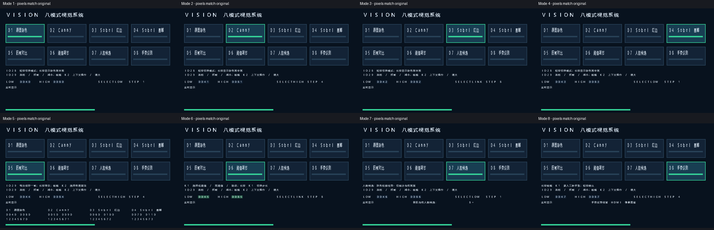

# Ti60 Vision8 CPU缓存与双屏字库 RAM 优化结果

日期：2026-10-12。目标器件：Ti60F225；Efinity：2025.1.110.5.9；仿真：Vivado 2018.3 XSim。

## 1. 工程与结论

- 原工程：`D:\yilingsi_fpga\Efinity_Project\2026.10.12\10_12_ding_Ti60_Vision8_Buttons_Integrated`。
- 新工程：`D:\yilingsi_fpga\Efinity_Project\2026.10.12\10_12_ding_Ti60_Vision8_CPU_Font_RAM_Optimized`。
- 原工程所有 2273 个文件与开始前哈希清单一致；未在原工程编译、修改 RTL、固件或下载文件。
- 新工程最终完整编译通过，生成了新的 `outflow/Ti60_Demo.bit` 和 `.hex`。
- RAM 从 **222/256 降到 212/256**，释放 **10 个 RAM 块**；空余从 34 块增加到 44 块。
- 原有功能回归、共享字库逐像素等价、真实 CPU 菜单与电子纸回归通过。Canny、分辨率、视频数据位宽和引脚约束未调整。
- 这是仿真和编译验证结果；本轮没有连接开发板进行下载或上板验收。

## 2. 最终资源与时序对比

| 资源 | 优化前 | 优化后 | 变化 |
|---|---:|---:|---:|
| Memory Blocks | 222/256（86.72%） | 212/256（82.81%） | -10 |
| XLRs | 44982/60800（73.98%） | 47482/60800（78.10%） | +2500 |
| DSP Blocks | 35/160（21.88%） | 35/160（21.88%） | +0 |
| Global Clocks (GBUF) | 14/32（43.75%） | 14/32（43.75%） | +0 |

| 时序 | 优化前 | 优化后 |
|---|---:|---:|
| 最差 Setup slack | 0.305 ns | 0.295 ns |
| 最差 Hold slack | 0.026 ns | 0.026 ns |

两项 slack 均不小于零，最终时序检查通过。资源数来自最终 `outflow/Ti60_Demo.route.rpt`；不以中间综合结果代替最终结果。

优化前报告虽然生成于 10.11，但本轮核对了当前 10.12 原工程的 486 项编译输入、位流及 HEX 哈希，全部与对应构建记录吻合。优化后则在新工程重新完整编译。

## 3. RAM 具体省在哪里

依据优化前后 `Ti60_Demo.map.v` 的 EFX_RAM10 / EFX_DPRAM10 实例归属计数：

| 模块 | 原 RAM 块 | 新 RAM 块 | 节省 |
|---|---:|---:|---:|
| CPU 指令缓存：数据和标签 | 6 | 2 | 4 |
| CPU 数据缓存：数据和标签 | 6 | 4 | 2 |
| HDMI 字库 | 7 | 0（进入共享字库） | — |
| LVDS 字库 | 5 | 0（进入共享字库） | — |
| 双屏共享字库 | 0 | 8 | 合计省 4 |
| CPU 寄存器文件 | 4 | 4 | 0 |
| CPU 程序 RAM | 16 | 16 | 0 |
| 其他模块合计 | 178 | 178 | 0 |
| **总计** | **222** | **212** | **10** |

CPU 指令缓存和数据缓存从各 4 KiB 调整为各 1 KiB。缓存行仍为 64 字节；每个缓存由 64 行改为 16 行，标签位随之扩展，读取索引、命中比较、刷新计数及装载地址同步调整。

每个标签表只剩 16×24 位，即 384 位，改为显式寄存器存放；读写仍按原来的同步时序执行。两个标签表共使用 768 位存储寄存器，避免小表继续占用 4 个整块 RAM。CPU其他模块、外部接口、16 KiB程序 RAM及生产固件保持原样。

数据缓存由四个可独立写入的字节通道组成，即使深度变小，实际仍需四块 RAM；没有把理论字节数减少误计成额外 RAM 节省。

双屏字库保留原 16×16 字形、字号和像素内容。原 LVDS 148 个字形，HDMI 209 个字形，共有 101 个重复字形，合并后为 256 个字形、4096 个 16 位行数据。真实双端口 RAM 按两个屏各自的时钟独立读出，保持原一拍字库读延迟，不引入跨时钟数据采样，也不新增显示帧缓冲。

## 4. 功能与画质保留证据

- 原工程的图像算法源文件逐项哈希一致；Canny、Gaussian、Sobel、形态学和其他图像算术未改。
- `parallel_video.v` 和叠加/UI模块只接入共享字库接口，视频处理逻辑不变。
- 原 firmware 及四路程序 RAM 初始化文件逐字节一致；电子纸原图片和解码程序保留。
- `Ti60_Demo.peri.xml`及用户时钟约束保持一致，IO28、IO29和板载K1/K2接法、按下电位及功能不变。
- 原图、Canny、Sobel红边、Sobel赛博、四帧对比、阈值调节、人脸候选统计、手势模式保留；画中画、冻结和录入操作保留。
- HDMI字库逐行与原版比较；LVDS八张完整1024×600输出图像与原工程PPM逐字节相同，文件哈希见 `UI_image_hashes.json`。

菜单预览：

## 5. 测试结果

本轮 **28 个仿真测试顶层全部通过**，不使用复制来的历史日志充当本轮结果。

| 测试组 | 覆盖内容 | 结果 |
|---|---|---|
| 15项原有回归 | 视频完整光栅、同图对照、手型录入、腕部招手、模板、肤色、按钮、摄像头I2C、健康状态、DDR帧路径、CDC等 | PASS |
| 7项Vision8回归 | 模式/阈值操作、FIFO、DDR并发/背压、画中画、四帧抓取/替换/清空、候选人数过滤、手势来源一致性、IO29实际冻结链 | PASS |
| 共享字库双时钟测试 | HDMI/LVDS两路同时读；65536/32768组字库请求；与原字形数据逐行比较 | PASS |
| 八模式UI等价测试 | 同时占用另一路字库端口；每模式614400像素；RGB/DE与原版逐拍一致；数字/选项/人数等字形完整 | PASS |
| 真实CPU缓存压力测试 | 1KiB索引冲突、完整地址标签、指令冲突、byte/halfword写掩码、fence与fence.i刷新 | PASS |
| CPU八模式短回归 | 真实生产固件更新完整640位状态，模拟帧边界提交；用于补充快速诊断 | PASS |
| 真实CPU八模式完整回归 | 真实生产固件、CDC、正常帧边界、全部八模式完整画面、每帧614400像素、853440时钟、LVDS打包 | PASS |
| 真实CPU电子纸回归 | 30033个SPI字节逐项比较、两组完整图像数据、复位、BUSY、完成状态，以及运行中的LVDS菜单 | PASS |
| 原工程保护和源文件校验 | 原工程全部文件、生产固件、算法、外设约束、CPU其他模块及缓存接口 | PASS |
| 完整Efinity流程 | Map、Interface、PNR、位流生成、最终Setup/Hold、输入清单与位流新鲜度 | PASS |

同一隔离缓存压力程序：原CPU使用 **38611** 个时钟，新CPU使用 **42503** 个时钟，增加约 **10.1%**。这反映冲突访问测试中的缓存未命中代价，不代表视频帧率降低。CPU在本工程负责状态镜像和电子纸控制，视频逐像素处理及屏幕时序由RTL完成；完整菜单及电子纸回归均已通过。

## 6. 关于“分 RAM 压力给 DSP”

本轮 DSP 仍为 **35/160**。缓存和字库需要保存可寻址数据；DSP主要适合乘法、加法、乘加流水线，不能直接替代这些存储。本轮实际采取的是：**减少重复字库存储 + 缩小缓存 + 把很小的标签表转为寄存器**。

没有把Canny、RGB、阈值或其他图像运算改写为新的DSP算法，也没有为提高DSP占用而额外添加逻辑。后续如果调整图像算法，可以将乘加运算交给DSP，并另行分析是否能减少中间数据缓存；需要逐像素等价或画质评估支持，不能按空余DSP数量推算RAM节省。

## 7. 文件与复核方法

- 工程入口：新工程 `Ti60_Demo.xml`。
- 下载文件：新工程 `outflow/Ti60_Demo.bit`；HEX同目录。
- 最终资源和时序：`outflow/Ti60_Demo.route.rpt`、`outflow/Ti60_Demo.timing.rpt`。
- 最终构建证明：`reports/build_verified.json`及`reports/vision8/build_input_sha256.json`。
- 对比、测试、哈希证据：`reports/cpu_font_ram/`，综合归属见`ram_attribution.json`，测试清单见`final_validation.json`。
- 共享字库：`rtl/shared_glyph_rom.v`、`shared_font.hex`。
- 真实缓存压力测试：`tools/test_cache_stress.ps1`；共享字库/画面等价：`tools/test_shared_font.ps1`。
- 全部原有及新回归入口：`tools/test_all.ps1`。完整重编译：`tools/build_fpga.ps1`。

缓存调整脚本`tools/prepare_cpu_font_ram.py`已在隔离目录验证能从原CPU重现最终RTL。`vendor/sapphire_original_settings.json`是保留的历史配置；实际缓存设置另记于`vendor/sapphire_optimized_settings.json`，后者是说明文件，不是厂商IP生成器配置。不要仅重新生成厂商SoC后直接覆盖优化RTL。

上板验收建议使用新目录的位流，确认IO28切换八模式、IO29冻结/恢复及抓拍、长按清空/画中画、阈值操作、人脸/手势状态，并确认HDMI/LVDS文字及电子纸原图片。仿真不能替代这一步硬件观察。

最终位流 SHA256：`424576e28488ed22f552cd1ef69cf0e4129e4c831812045d46985ca2aa5ca0c6`。

最终 HEX SHA256：`8f974975c20ee7b62316441b762e0dd2f9b338bf83a5906a59ca90e002321c2f`。
