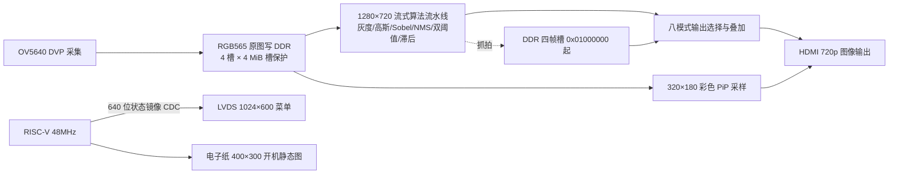

# 基于 Ti60 FPGA 的实时图像边缘检测与多模式交互系统

（竞赛技术文档·重写版　2026-10-13）

## 中文摘要

本文档面向 FPGA 创新设计竞赛，系统介绍一套基于易灵思 Ti60F225 的实时图像处理与交互系统。系统以 OV5640 摄像头为视频输入，RGB565 原图存入外部 DDR，1280×720 像素流在纯 RTL 流水线上完成灰度化、3×3 高斯平滑、Sobel 梯度、非极大值抑制、双阈值分类与局部滞后连接，构成实时 Canny 边缘检测；在此基础上实现红边、赛博两种风格化效果，以及四帧算法对比、Canny 阈值在线调节、人脸轮廓候选统计、手势识别四种交互模式。像素数据平面完全由 RTL 完成，48 MHz RISC-V 软核只负责状态镜像、菜单与电子纸控制，HDMI 输出图像、1024×600 LVDS 输出菜单、4.2 英寸电子纸显示开机静态图。本文档严格区分仿真、工具实现与实物实测三种验证状态：本版本未进行实物板验收，识别准确率、功耗、端到端延迟、帧率、下载成功等一律标注"待测"，材料未覆盖的细节集中列入附录 D，不做虚构。

**关键词**：Ti60 FPGA；Canny 边缘检测；手势识别；人脸候选统计；RISC-V；实时图像处理

## 目录

- 第一部分　总体方案
- 第二部分　关键实现与验证
- 第三部分　集成、操作与验证结果
- 第四部分　结论与改进方向
- 参考文献
- 附录 A　术语与参数速查
- 附录 B　图片清单
- 附录 C　文档更改记录
- 附录 D　缺失项与待验证清单

---

# 第一部分　总体方案

## 1.1 设计目标与功能定义

本系统的设计目标是在单颗 Ti60 FPGA 上完成"摄像头采集—DDR 帧缓存—流式算法处理—多屏交互显示"的完整链路，并以"算法效果可同屏对比、参数可在线调节、手势可现场录入"作为竞赛展示亮点。面向用户的功能共八个模式，依次为：

| 用户模式 | 名称 | 功能定义 |
| --- | --- | --- |
| 1 | 原图 | 显示 OV5640 采集的 RGB565 原图，支持冻结/恢复 |
| 2 | Canny 边缘 | 实时 Canny 边缘检测，支持彩色画中画 |
| 3 | Sobel 红边 | 原始 Sobel 强边缘以红色叠加显示，支持画中画 |
| 4 | Sobel 赛博 | 暗底霓虹色分段映射的赛博风格边缘，支持画中画 |
| 5 | 四帧对比 | 四格同屏保存对比四种算法处理结果，含元数据 |
| 6 | 阈值调节 | Canny 高/低阈值及 LINK 联动在线调节 |
| 7 | 人脸候选统计 | 肤色轮廓候选检测与计数框选（0 / 数字 / 8+） |
| 8 | 手势识别 | 张掌/点赞/单手比心模板录入与识别，挥手检测 |

灰度、形状、测试彩条等维护入口通过 UART 保留，不计作用户模式。除 UART（字符 `0`～`7` 对应模式 1～8，`m` 切下一模式）外，交互由两路外接按键 IO28/IO29 与板载 K1/K2 四键完成。

## 1.2 系统总体架构

系统按"采集—缓存—处理—显示"四级组织，像素平面与控制平面严格分离：



划分原则：**像素通路不经过软件，控制通路不进入像素时序**。RISC-V 仅以状态镜像和寄存器接口参与系统，视频逐像素处理、叠加与扫描时序全部由 RTL 完成，从机制上消除了软件抖动对画面的影响。

由此延伸出三条贯穿全文的设计原则：其一，**帧边界原子提交**——模式、冻结、阈值等控制量都在帧边界整体切换（如阈值在帧边界生效、四帧抓拍先写临时槽再原子发布），避免一帧内新旧参数混杂；其二，**一切状态可追溯**——每张抓拍图绑定算法、阈值、参数版本与源帧号，状态镜像向量完整暴露错误与欠载标志，问题定位不需要猜测；其三，**诚实的状态语义**——人数区分 0/未知/8+，识别区分"录入中/已训练/无帧计时"，不把未知包装成确定。

## 1.3 数据流与关键参数

- 输入：OV5640 DVP，RGB565 像素流，I²C 寄存器配置；
- 分辨率：1280×720，行总周期长参数 H_TOTAL=1650；
- 像素时钟：约 74.4 MHz（SDC 周期 13.4409 ns，STA 表中约 74.399 MHz；源码部分注释沿用 74.25 MHz 标称，gesture_branch 的 CLOCK_HZ=74400000）；
- 软核时钟：48 MHz（LVDS 复用 48/336 MHz PLL）；
- 像素流水寄存延迟 DELAY = 4×(H_TOTAL+1)+14，H_TOTAL=1650 时为 6618 拍（含消隐，约 89 µs @74.4 MHz）。该值是流水线寄存延迟，**不等于**摄像头采集至显示的全系统端到端延迟，端到端延迟待测；
- 显示：HDMI 输出图像；LVDS 独立输出 1024×600 菜单；电子纸仅显示开机静态图，未实现手势触发换图或外接图片 Flash。

## 1.4 工程组织与工具链

- 目标工程：`10_13_ding_Ti60_Vision8_Gesture_ROI_Integrated`；
- 版本演进：Vision6 六模式基线 → 10-11 八模式四键集成 → 10-12 CPU 缓存与双屏字库 RAM 优化 → 10-13 手势 ROI 统一扩大融合。本工程由 10-12 优化工程完整复制，仅迁入 Gesture_ROI 工程的四个统一范围参数（检测掩膜、候选边界检查与 HDMI 大框同步扩大到 (40,40)～(1000,680)），CPU 缓存、共享字库、八模式、Canny/Sobel 算法、固件与引脚配置全部沿用主工程；
- 器件：易灵思 Ti60F225；EDA：Efinity 2025.1.110.5.9（综合、接口生成、布局布线、时序与位流）；
- 仿真验证：Vivado 2018.3 XSim，28 项回归全部 PASS，另有 2 项 ROI 集成测试 PASS；
- 下载文件：`outflow/Ti60_Demo.bit`（JTAG/SRAM）与 `outflow/Ti60_Demo.hex`（配置 Flash）；
- 文档口径：本文引用的资源、时序与 PASS 结果均来自 2026-10-13 已有的报告记录（route.rpt 生成时间为 2026-10-13 12:51），不是本次写作时重新编译、重新仿真或重新上板的结果。

---

# 第二部分　关键实现与验证

本部分为全文重点，逐模块说明实现机制、关键参数与验证状态。

## 2.1 时钟规划与跨时钟域

系统是一个多时钟设计。STA 报告（Ti60_Demo.timing.rpt，2026-10-13 12:52，时序模型 C4、typical 工艺、0～85 ℃、0.95 V±30 mV、速度等级 4）中受约束的时钟包括：

| 时钟 | 周期 (ns) | 频率 (MHz) | 用途 |
| --- | ---: | ---: | --- |
| clk_pixel | 13.441 | 74.399 | 像素处理与 HDMI 扫描域 |
| clk_pixel_10x | 1.344 | 744.048 | 像素 10 倍频（显示串行） |
| clk_lvds_1x | 20.833 | 48.001 | LVDS 菜单与软核域 |
| clk_lvds_7x | 2.976 | 336.022 | LVDS 7 倍串行时钟 |
| clk_sys | 10.417 | 95.997 | 系统时钟域 |
| core_clk / tdqss / tac / twd | 5.208 / 2.604 | 192 / 384 | DDR 控制器 PHY 时钟组 |
| cmos_pclk | 10.000 | 100.000 | 摄像头像素时钟（输入约束） |
| clk_27m | 62.500 | 16.000 | 基础参考时钟 |

SDC 约束（Ti60_Demo.pt.sdc）对上述时钟显式建组：DDR PHY 四钟为一组；core_clk 与 clk_sys 之间用 set_max_delay 4.5 ns 限定；clk_sys 与 clk_pixel、cmos_pclk、CSI 时钟之间以及 dsi_byteclk_i 与 clk_lvds_1x/clk_sys/clk_pixel 之间设为 false path。也就是说，**跨域数据通路不靠时序约束兜底，而是由模块级握手与 FIFO 保证**（见下文），约束只负责把不分析的通路声明清楚。像素域到 LVDS/软核域之间不直通任何控制信号，而是经打包状态向量跨域：

- 顶层将冻结提交、用户模式、摄像头健康、PiP 使能、抓拍忙、人脸计数/有效/饱和、手势类别/训练状态/倒计时、阈值低/高/选中/步长、参数版本、源帧号、有效格数、抓拍算法、存储器/AXI/欠载/抓拍错误及抓拍元数据等字段拼成 640 位 `menu8_pixel` 状态向量；
- `menu_status_cdc` 采用 bundled-data toggle 握手：请求与应答各经两级同步器，payload 保持至应答返回，保证 640 位宽状态在不丢比特的前提下跨域；
- 另有 13 位精简状态向量走第二个 `menu_status_cdc` 实例。

跨时钟小 FIFO 共新增两路、8 个 RAM 块，其随机停顿、满/空、1200 字跨指针回绕行为经专项仿真验证 PASS。各路复位释放顺序在材料中未见完整描述，列入附录 D。

## 2.2 OV5640 图像采集与 DDR 原图缓存

摄像头经 I²C 配置后输出 DVP 像素流。原图采用 4 个 DDR 槽循环写入，槽地址步长 4 MiB，区域 0x00000000～0x00FFFFFF。冻结、显示与 PiP 会保护正在使用的原图槽，摄像头继续写入其他槽，从而冻结画面不影响采集连续性——这是"冻结"与"停止采集"的本质区别：前者只切换读取端，后者才会打断写入端。摄像头 I²C 初始化流程在 15 项保留回归中有专项覆盖，初始化寄存器序列未在本轮改动。摄像头健康诊断与 UART 维护入口（灰度、形状、测试彩条等）自既往版本完整保留，健康状态以像素级信号注入状态镜像，供菜单显示与手势/人脸通路门控：手势通路要求健康位有效才工作，人脸计数在源无效时显示"未知"而非累计数字。采集稳定性（丢帧、错行、现场带宽）目前仅有仿真与行为模型证据，实物表现待测，本文不声称"持续零丢帧"。

## 2.3 Canny 边缘检测流水线

Canny 链路是系统的算法核心，完整流水为：**RGB565→灰度 → 3×3 中值 →（宏 CANNY_GAUSSIAN=1）3×3 高斯 → Sobel 梯度 → 非极大值抑制（NMS）→ 双阈值分类 → 局部滞后连接**。当前顶层设置 CANNY_GAUSSIAN=1，即使用 3×3 高斯核，**不是 5×5 高斯**。

各级的实现要点：

1. **灰度化**（`rgb565_to_gray`）：各通道先按 MSB 复制扩展到 8 bit（比单纯左移更接近满量程，黑 0/白 255 两端可取到），再计算 Y=(77·R+150·G+29·B)>>8。三个权重之和恰为 256，结果天然落在 [0,255]，无需饱和处理；乘法全部展开为移位加法（77=64+8+4+1，150=128+16+4+2，29=32−2−1），不消耗 DSP；单级流水，de/x/y 同步透传。
2. **高斯平滑**（`gaussian3x3`）：在 3×3 窗口上完成，输出再经开窗进入梯度级。
3. **Sobel 梯度**（`sobel3x3`）：幅值采用 L1 近似 |Gx|+|Gy|，12 bit 表示，理论满量程 2040——这正是阈值上限 2040 的来源；同时输出 2 bit 方向供 NMS 使用。另有一路"原始 Sobel"直接挂在灰度中值窗口上（不走高斯），为灰度预览与赛博模式保留微弱细节。
4. **NMS**：对梯度幅值按方向做 3×3 非极大值抑制，细化边缘。
5. **双阈值分类**（`canny_threshold`）：把 NMS 幅值分三档——≥HIGH 为强边（编码 2），≥LOW 为弱边（编码 1），其余非边（编码 0）。分类结果以 2 bit 编码作为"像素"送下一级行缓存，一个编码同时承载强弱两种判决，无需额外标志位线。阈值来源二选一（编译期参数/运行时端口），当前实例 USE_PORTS=1，走运行时端口。该模块曾存在"高阈值取端口、低阈值却取写死参数"的历史 bug，已修复，两个阈值统一由运行时输入控制。
6. **滞后连接**（`hysteresis_local`）：采用 FPGA 常用的**单遍 3×3 近似**——中心为强边则保留，中心为弱边且 8 邻域内至少一个强边则保留，其余丢弃。**它不是全帧递归传播**：经典 Canny 的弱边被激活后可继续激活更远弱边形成长链，本实现的"弱-弱-强"长链远端会断开一节。这是为流水化与确定时延做的明确取舍，上游有 NMS 与双阈值把关，多数场景边缘质量已足够；若实拍断边严重，可再迭代一级（输出回灌再过 3×3）或改用更大的确认窗口。

参数体系：

- 默认 LOW=40、HIGH=80，可调范围 1 ≤ LOW < HIGH ≤ 2040，步长 1/4/8 可选，参数在**帧边界**生效；
- 经验比例 HIGH : LOW ≈ 2:1～3:1；调参规律：边缘断裂多→降 LOW；噪点多→升 LOW；全黑/边缘丢失→降 HIGH（与 LOW）；
- 冻结/预览通路中 Sobel 强边缘判定固定为幅值 ≥ 40（`sobel_binary`），**该阈值不随 Canny 高/低阈值调节变化**；
- 已保存的四帧图片及其元数据不会因后续调参而改变。

验证状态：Canny 各级在 28 项仿真回归（含 720p 算法链 7 帧验证）中通过；实物屏幕观感、断边情况与定量指标待测。

## 2.4 红边与赛博模式

两种风格化共用边缘计算结果，仅色彩映射不同，不新增边缘算术开销：

- **红边模式**：原始 Sobel 通路幅值 ≥ 40 的像素直接以纯红色显示，其余像素显示原图，形成"红边压彩图"的效果；
- **赛博模式**：对同一原始 Sobel 强度做分段霓虹映射——强度低于 24 直接置黑；24～63 映射为绿色渐变；64～127 映射为青色；128～191 映射为蓝紫色；192 以上映射为品红，暗底高对比的赛博观感由这五段查表式映射直接得出，无需乘法运算。

两种模式均支持 320×180 彩色原图画中画。已知问题：动态画面边缘破碎仍待后续 Canny 专项调整，该问题在材料中被如实记录。

## 2.5 四帧对比模式

四帧对比是展示层的核心亮点，其定位是**静态抓拍对比**，不是录像或视频回放。实现机制：

- 抽样与容量：按 1280×720 视频每隔一行、每隔一列取样，保存 640×360 RGB565 处理结果，每张 460 800 字节；
- 槽位：使用 5 个 512 KiB 物理槽，从 0x01000000 起，至 0x0127FFFF。4 个为已提交显示槽，1 个为临时写入槽——新图先写临时槽，确认写入完成且 AXI 写响应成功后才原子发布，避免"覆盖了当前可见旧图才发现写入失败"；
- 替换顺序：左上→右上→左下→右下，第五次替换左上，然后循环；
- 元数据：每张图绑定算法、LOW、HIGH、阈值参数版本和原图帧编号，HDMI 四格直接显示处理结果，LVDS 同时显示四张图的参数，保证对比可追溯；已提交图像在模式切换后保留，长按清空或断电才丢失；
- 交互：板载 K2 在 原图→Canny→红边→赛博 之间选择下一张抓拍算法，IO29 短按抓拍；忙时忽略新抓拍和算法切换；长按 IO29 清空所有图片；
- 一致性保障：中途清空或离开模式会取消发布，并先排空已接受的 AXI 事务再切换槽/FIFO；写错误不发布抓拍结果；AXI 地址/数据在停顿期间保持并等待真实写响应；读取中断时先排空旧事务再切换；欠载后本帧剩余部分使用占位，下一帧重试，**不会追读旧数据继续错位显示**——但欠载前已输出的像素无法撤回。

验证状态：四帧/PiP 控制在仿真中覆盖四次顺序抓拍、第五次替换、元数据绑定、清空取消与欠载恢复（DDR 数据路径测试采用 64×48 参数化图像，配合真实生成的 FIFO 与 AXI 行为模型逐字核对）；完整 720p 摄像头→DDR→四帧现场带宽与画面验证待测。

## 2.6 阈值调节模式

模式 6 是 Canny 参数的独立调参页面：

- K1 短按在 LOW→HIGH→LINK 之间循环选择；K1 长按切换步长 1→4→8；
- K2 短按增大选中参数，IO29 短按减小；
- LINK 模式对高低阈值做等量移动并保持间距，到达边界饱和；
- 参数在帧边界生效，与已存图片元数据解耦（见 2.3）；步长 1 用于精细微调，步长 8 用于快速扫参，LINK 则适合在保持边缘密度不变的前提下整体平移灵敏度区间。

## 2.7 人脸轮廓候选统计模式

人脸功能是基于**肤色、形态学和区域几何条件的轮廓候选检测与统计，不是深度学习人脸模型，不是身份识别，也不是经过验证的客流统计产品**。实现链路：

1. **肤色分割**：RGB565→YCbCr，按编译期参数过滤（Cb 77～127、Cr 133～173、Y 40～235）；
2. **形态学去噪**：`face_morph` 中值滤波，干净掩膜保留 2 像素零边界，保证连通域标记的正确性；
3. **网格区域统计**（`face_grid_regions`）：按网格聚合肤色连通区域，候选框须同时满足最小宽 40、最小高 48、最大宽/高 640、最小面积 1800、填充率 ≥ 25%、宽高比（×10）在 6～16 之间的几何条件；
4. **计数确认**（`vision8_count_filter`）：人数需 **3 个不同的有效摄像头帧**确认后才发布——同一冻结帧反复显示不累计确认；冻结时保留稳定结果；有效空画面计数为 0；摄像头/通道无效时显示"未知"；候选框与计数在 HDMI 与 LVDS 两屏同步显示；
5. **上限**：最多 8 个候选，超出显示 8+。

验证状态：肤色区域及人数过滤仿真覆盖 9 个独立区域→8+、有效空帧→0、3 帧确认、冻结/失效恢复；复杂背景、肤色相近物体、遮挡与光照下的误检漏检率待现场样本验证。

## 2.8 手势识别模式

手势模式链路最长，实现要点如下：

- **ROI**：检测掩膜、候选边界检查与 HDMI 大框统一为 (40,40)～(1000,680)（1280×720 坐标，含边界）。指尖与左右两侧须保持在大框内，**顶部及左右裁切被拒绝**；底部允许手腕伸出框外（`ALLOW_BOTTOM=1`）；右侧轮廓预览位置不变；
- **录入流程**：用户依次录入张掌、点赞、单手比心三类模板。板载 K1 长按约 2 秒进入/重新录入，短按确认步骤。录入时张掌盖住画面中心的 32×32 采样框（中心坐标 560,360，屏幕显示为粉色小框）完成掌心肤色学习，随后按屏幕倒计时保持稳定（倒计时按真实时间推进，约 2 秒），再依次录入另两类手势；录入向导参数为倒计时 120 帧、稳定 15 帧、超时 360 帧（带源标记的测试源对应 32/4/96）；
- **预处理**：肤色学习 → 7×7 圆盘结构元滤波 → 3×3 腐蚀、膨胀闭运算去孔洞，ROI 内做游程编码连通域标记与候选统计（候选最小宽 80、最小高 80、最小面积 9216）；
- **特征与匹配**：对合格候选提取 16×16 归一化轮廓位图，与三类模板比对（模板匹配器约 241 拍完成）；特征框与原始候选框须相互容差匹配（尺寸差约 ±25% 以内）；
- **稳定机制**：识别结果经多帧稳定器确认后才输出；录入期间的帧同样推进时域滤波；**同一源摄像头帧去重**——重复显示同一帧不推进识别确认，防止静止画面累积出假阳性；
- **挥手检测**：独立于模板分类，要求三类模板全部录入（trained==7）、存在张掌证据（填充 200～880、宽高比 450～2600 范围内）并伴随往返摆动——摆动评分达到 18、水平幅度 ±140 像素、至少 3 次方向转换、累计水平位移大于 70 像素、有效样本数大于 10 时才确认，输出挥手有效与摆动相位；挥手优先级高于模板分类结果；
- **样本持久性**：肤色与模板样本保存在运行状态中，**模式切换和冻结/恢复保留样本，但重新下载、上电或复位后必须重新录入**。

验证状态：手势帧门控及录入（重复帧不确认、不同帧确认、无帧计时、超时与退出取消）与 2 项 ROI 集成测试在 XSim 中 PASS；识别准确率、挥手检出距离/角度范围待测。

## 2.9 交互界面与软核分工

- **软核分工**：48 MHz RISC-V 只负责状态镜像、LVDS 菜单与电子纸控制；像素算法、叠加与视频扫描由 RTL 完成。UART `0`～`7` 选择模式 1～8，`m` 下一模式；
- **LVDS 菜单**：独立的 1024×600 LVDS 输出，复用 48/336 MHz PLL；八模式 UI 逐像素仿真覆盖 LOW/HIGH/LINK、数字、步长与人数 8+ 显示；
- **电子纸**：4.2 英寸 V2 墨水屏，仅显示 400×300 开机静态图片（仿真验证 30 033 个 SPI 字节、两幅图片、复位/BUSY/休眠流程）；未实现手势触发换图；
- **共享字库优化**：原 LVDS 148 个字形、HDMI 209 个字形中有 101 个重复，合并为 256 字形、4096 个 16 位行数据的双端口共享字库，两个屏按各自时钟独立读出，保持原一拍读延迟，不引入跨时钟数据采样，也不新增显示帧缓冲；
- **CPU 缓存优化**：指令与数据缓存各从 4 KiB 缩为 1 KiB（缓存行仍为 64 字节，行数 64→16），两个标签表各仅 384 位，改为显式寄存器存放。代价如实记录：隔离缓存压力程序时钟数从 38 611 增至 42 503（约 +10.1%，反映冲突未命中代价，不代表视频帧率下降），该阶段 XLR 增加 2 500、最差建立余量从 +0.305 ns 变为 +0.295 ns。RAM 从 222 块降至 212 块（指令缓存省 4、数据缓存省 2、双屏字库合并省 4），DSP 维持 35/160——缓存与字库需要可寻址存储，DSP 适合乘加流水，不能直接替代，本轮未做"分 RAM 压力给 DSP"的改写；
- **LED 指示**：LD1～LD6 分别指示心跳、手势、冻结、PiP、挥手与初始化完成，调试时无需接屏幕即可判断系统处于哪个状态分支；
- **双屏同显**：图像结果走 HDMI，参数菜单走 LVDS，两屏内容由同一份状态镜像驱动，天然保证"看到的参数就是此刻生效的参数"。

## 2.10 资源占用与时序收敛

最新 ROI 融合版最终报告（Efinity 2025.1，route.rpt 生成于 2026-10-13 12:51）：

| 指标 | 占用 | 总量 | 利用率 |
| --- | ---: | ---: | ---: |
| XLR 逻辑单元 | 47 600 | 60 800 | 78.3% |
| Memory Blocks | 212 | 256 | 82.8% |
| DSP | 35 | 160 | 21.9% |
| GBUF | 14 | 32 | 43.8% |

时序：最小建立余量 +0.302 ns（出现在 core_clk→twd_clk 的跨组路径上，约束 0.541 ns），最小保持余量 +0.026 ns，两项均不小于零；像素域自身路径（clk_pixel→clk_pixel）的建立余量为 3.135 ns，LVDS 域自身路径为 7.220 ns。STA 报告的 maximum possible analyzed frequency 中 clk_pixel 为 97.031 MHz——**这是时序分析工具给出的上限估计，既不是实际工作频率，也不是实测帧率**；系统实际运行在约 74.4 MHz 像素时钟与 48 MHz 软核/LVDS 时钟。XLR 占用的构成：纯逻辑 21 481、逻辑加触发器 7 222、加法器 4 596、加法器加触发器 1 225、纯触发器 12 554、SRL8 移位寄存器 522；输入 71/1703、输出 439/2267。DSP 打包器报告 35 个 DSP48 为合法占用，优化后最好情形可回收 1 个（34 个），本轮未做该项微调。整流程耗时约 8 分 14 秒。功耗数据材料中未见，待测。

需要说明两点口径：其一，CPU/字库优化阶段的中间数字（XLR 47 482、setup +0.295 ns 等）与旧位流哈希不属于最新融合版，本文一律以 47 600 / +0.302 ns 的最新报告为准；其二，RAM 块利用率（82.8%）不能直接等同于有效图像字节数，缓存与字库的具体归属见 2.9 节。

余量评估：XLR 尚余 13 200 个（21.7%），RAM 尚余 44 块，DSP 尚余 125 个，GBUF 尚余 18 个。按本轮经验，八模式集成新增 XLR 约 9 557、RAM 7 块，据此估算现有余量大致还能容纳一至两轮同等规模的功能扩展；但 DDR 带宽与 RAM 块是两个独立的瓶颈维度，后续若增加整帧级缓存类功能，应先做 RAM 预算再动工。

---

# 第三部分　集成、操作与验证结果

## 3.1 上电与一键下载流程

设计交付目标为一键下载上电：FPGA 配置完成后软核初始化外设、向电子纸推送开机静态图、点亮状态 LED，随后进入模式 1 原图显示。下载文件为本工程 `outflow/Ti60_Demo.bit`（JTAG/SRAM 方式）与 `outflow/Ti60_Demo.hex`（配置 Flash 方式）；注意配置 Flash 与规划中未实现的外接图片 Flash 是两项不同功能。具体的下载器型号、接线与点击步骤在材料中未见完整记录，列入附录 D；**"下载成功"本身属于实物验收项，当前状态为待测**，工具的位流生成/pgm PASS 不能替代实际 JTAG 操作与板上观察。

## 3.2 按键操作定义

四路按钮为两路外接按键加板载 K1/K2。外接连接器侧为 3.3 V，FPGA 端按现有电平转换配置为 1.8 V LVCMOS 普通输入；四路均使用双触发同步、20 ms 双边消抖、约 2 s 长按判定时长；**短按在松开时生效，长按只触发一次且释放不再产生短按；按住期间切换上下文会取消该按键原动作**。

| 物理按钮 | 管脚 | 模式 1～4、7 | 模式 5 四帧 | 模式 6 阈值 | 模式 8 手势 |
| --- | --- | --- | --- | --- | --- |
| IO28（J6，DC3-40 第 33 脚） | C1 / GPIOL_N_16 | 短按下一模式；模式 2～4 长按开关 PiP | 短按到模式 6 | 短按到模式 7 | 短按到模式 1 |
| IO29（J7，DC3-40 第 34 脚） | D1 / GPIOL_P_16 | 短按冻结/恢复 | 短按保存一帧；长按清空四格 | 短按减小选中参数；长按冻结/恢复 | 非录入期间冻结/恢复 |
| 板载 K1 | N2 / GPIOL_P_02 | — | — | 短按 LOW→HIGH→LINK；长按步长 1→4→8 | 长按进入/重新录入；短按确认录入步骤 |
| 板载 K2 | M2 / GPIOL_N_02 | — | 短按切换抓拍算法（原图→Canny→红边→赛博） | 短按增大选中参数 | 暂不分配 |

PiP 画中画为 320×180 彩色原图，位于 HDMI (944,16)，右侧与顶部各保留 16 像素，绿色边框，像素取自 DDR 原图槽，不对边缘图做反向还原。

## 3.3 验证结果汇总

| 验证项 | 工具/环境 | 结果 | 性质 |
| --- | --- | --- | --- |
| 回归测试 28 项 | Vivado 2018.3 XSim | 全部 PASS | 仿真 |
| ROI 集成测试 2 项 | Vivado 2018.3 XSim | 全部 PASS | 仿真 |
| 时序收敛 | Efinity 2025.1 STA | 建立/保持余量为正 | 工具实现 |
| 资源占用 | Efinity 2025.1 | 见 2.10 节 | 工具实现 |
| 识别准确率、功耗、端到端延迟、帧率、实物下载、长期稳定性 | — | 待测 | 实物验收 |

28 项回归的分组覆盖：新按钮控制（抖动、短/长按、上下文取消、八模式、阈值边界）、异步 FIFO（随机停顿、满/空、1200 字跨指针回绕）、DDR 行为模型与真实生成 FIFO（AXI 随机停顿、写响应等待、槽保护、结果回读、错误不提交、原图字节序与 PiP 采样）、四帧/PiP 控制（顺序抓拍、第五次替换、元数据绑定、清空取消、欠载恢复）、肤色区域及人数过滤（9 区域→8+、空帧→0、3 帧确认、冻结/失效恢复）、手势帧门控及录入、八模式 UI 逐像素（八张 1024×600 图）、真实 RISC-V 八模式（CPU 启动、APB 搬运、640 位原子状态、帧边界提交、LVDS 打包；每帧 614 400 像素）、真实 RISC-V 电子纸（30 033 个 SPI 字节、两幅图片、复位/BUSY/休眠）、15 项保留功能回归（含原手势录入/招手、肤色/模板/叠加、720p 算法链 7 帧、I²C、健康状态、帧路由及菜单 CDC）、字模紧凑银行逐字核对与最终完整 Efinity 流程（map/interface/pnr/pgm、STA、编译前后哈希）。

边界说明：DDR/四帧数据路径测试使用 64×48 参数化图像逐字核对；1280×720 原算法链单独验证 7 帧。这**不等同于**完整 720p 摄像头→DDR→PiP/四帧的现场带宽与画面验证，后者只能在开发板上完成。

## 3.4 开发板验收顺序（既定方案）

材料给出了完整的板上验收步骤，作为后续实物验收的执行依据：① 下载最终 bit，确认原图、摄像头初始化、LVDS 菜单与电子纸静态图正常；② IO28 短按遍历 8 模式，在 Canny/红边/赛博长按验证 PiP 并检查运动画面是否欠载；③ IO29 验证冻结；四帧模式依次抓四张不同场景/算法，核对顺序、第五次替换与长按清空；④ 阈值模式核对 K1 选参/步长、K2 加、IO29 减与菜单数值和边缘变化的一致性；⑤ 人脸模式在空画面、单人、多人与复杂背景下检查框选与 0/未知/8+ 提示；⑥ 手势模式完成录入与识别，测试招手/点赞/比心及冻结/退出，确认电子纸仍完成原静态刷新。上述步骤截至本文档撰写时**尚未执行**。

## 3.5 工程完整性与可复现性

工程迭代采用"完整复制＋逐文件核对"的保护方式：每次新工程从上一工程完整复制后，对原工程全部文件（数千个）逐一核对 SHA256 与文件集合，确认未修改、未增删文件，核对结果留存于 preservation_verified.json 等结构化记录。编译方面，最终验证逐一检查 28 项原有回归与新增 ROI 日志的新鲜度、构建阶段、时序、资源、bit/hex 哈希，以及两个原工程文件集合与哈希（build_input_sha256.json、delivery_verified.json、run_started.json）。一个值得记录的细节是：Efinity 会改写项目 XML 的运行元数据，工程通过恢复原时间戳并比对编译开始时保存的原始 SHA256，证明 XML 唯一变化是 last_change 字段，设计内容逐字节一致（build_xml_timestamp_verified.json）；验证脚本正确传递失败退出码，不会因脚本问题把失败吞掉。

复现与回归入口（在工程目录执行）：

```powershell
& .\tools\test_all.ps1 -VivadoBin 'D:\Xilinx\Vivado\2018.3\bin'      # 28 项全回归
& .\tools\test_gesture_roi.ps1 -VivadoBin 'D:\Xilinx\Vivado\2018.3\bin'  # 2 项 ROI 集成测试
& .\tools\build_fpga.ps1 -Efinity 'C:\Efinity\2025.1'                 # 完整 Efinity 编译
& 'C:\msys64\mingw64\bin\python.exe' -X utf8 .\tools\verify_roi_integration.py  # ROI 融合核验
```

上述命令是材料记录的可复现路径；本文档撰写时未重新执行其中任何一条。

---

# 第四部分　结论与改进方向

本系统在 Ti60F225 上以纯 RTL 像素流水实现了完整 Canny 边缘检测及红边、赛博两种风格化变体，并在此之上构建了四帧抓拍对比、阈值在线调节、人脸候选统计、手势识别四层交互，软硬分工明确。功能层面：28 项仿真回归与 2 项 ROI 集成测试全部通过，时序与资源在 Efinity 2025.1 下收敛（XLR 利用率 78.3%，RAM 82.8%，建立余量 +0.302 ns）。

主要技术取舍：滞后连接采用单遍 3×3 近似换取流水确定时延，代价是"弱-弱-强"长链远端可能断边；人脸采用肤色加几何条件方案换取极低资源占用，代价是光照与肤色差异敏感；手势样本保存在易失状态中换取实现简单；CPU 缓存与双屏字库优化用约 +10.1% 的缓存压力时钟和 2 500 个 XLR 换取 10 个 RAM 块。

从工程方法看，本项目的另一项可借鉴之处在于过程纪律：每一轮迭代都以逐文件 SHA256 核对保护前序工程，以结构化 JSON 记录构建输入、位流新鲜度与交付证据，用"恢复时间戳比对 XML"的方式区分工具元数据变化与设计变化。正是这种"每步可复核、每数有出处"的做法，使得本文档能够把仿真、工具与实测三种口径清晰分开，也让尚未完成的实物验收成为一份可以照单执行的计划（3.4 节），而不是一句含糊的"待后续验证"。

已知未决问题与后续方向：动态画面边缘破碎待 Canny 专项调整（可考虑滞后再迭代一级或更大确认窗口）；外接图片 Flash、编码器与 Canny 连边算法优化未实现；手势样本可增加非易失保存；人脸可引入更鲁棒的特征并补充现场样本验证；最后也是最重要的一项——按 3.4 节顺序完成实物板验收，补齐全部"待测"指标。

---

# 参考文献

[1] 工程材料：10_13_ding_Ti60_Vision8_Gesture_ROI_Integrated 设计资料与 README（2026-10-13）。
[2] Efinity 2025.1 实现报告：Ti60_Demo.route.rpt / timing.rpt（2026-10-13 口径）。
[3] Vivado 2018.3 XSim 回归与 ROI 集成测试记录（28+2 项 PASS）。
[4] Canny J. A Computational Approach to Edge Detection. IEEE TPAMI, 1986.
[5] ITU-R BT.601 数字视频编码参数（YCbCr 色彩空间参考）。

---

# 附录 A　术语与参数速查

- 分辨率/时序：1280×720，H_TOTAL=1650；像素流水延迟 DELAY=4×(H_TOTAL+1)+14=6618 拍（含消隐）；形态学级 MORPH_DELAY=2×(H_TOTAL+1)+7；RAW 级 RAW_DELAY=(H_TOTAL+1)+4；
- 时钟：像素域约 74.4 MHz（SDC 13.4409 ns）；软核/LVDS 域 48 MHz（LVDS 336 MHz）；
- DDR 原图槽：4 槽，步长 4 MiB，0x00000000～0x00FFFFFF；四帧槽：5×512 KiB，0x01000000～0x0127FFFF，单张 460 800 B；
- Canny：默认 40/80，范围 1≤LOW<HIGH≤2040，步长 1/4/8，帧边界生效；Sobel 幅值 L1 满量程 2040；预览强边缘阈值固定 40；
- 肤色：Cb 77～127，Cr 133～173，Y 40～235；人脸候选：8 上限（8+），最小 40×48，最大 640×640，最小面积 1800，填充率 ≥25%，宽高比×10∈[6,16]，3 帧确认；
- 手势：ROI (40,40)～(1000,680) 含边界；掌心采样 32×32 @ (560,360)；7×7 圆盘＋闭运算；16×16 归一化轮廓；三模板多数表决；向导 120/15/360 帧；挥手需张掌证据＋往返摆动；
- 跨时钟：menu_status_cdc 为 bundled-data toggle 握手，request/ack 各两级同步；
- 内部模式编码（供源码对照）：parallel_video 内部 mode 1=Canny 二值边缘、9=赛博霓虹、10=红边、15=手势通路使能；用户模式 1～8 到内部编码的完整映射以顶层与 vision6_overlay 源码为准；
- UART 维护：字符 `0`～`7` 选择模式 1～8，`m` 切下一模式；灰度、形状、测试彩条为维护入口；
- 交付文件：`outflow/Ti60_Demo.bit`（JTAG/SRAM）、`outflow/Ti60_Demo.hex`（配置 Flash）；顶层实体 Ti60_Demo。

# 附录 B　图片清单

材料目录中可用的预览图均为仿真/测试状态的预览，**不是实物屏幕照片**：

| 文件 | 内容 |
| --- | --- |
| reports/vision8/lvds_eight_modes_final.png | 八模式 LVDS 菜单逐像素仿真预览 |
| shared_UI_preview.png | 共享字库菜单预览 |

实物效果照片、波形截图待补。

# 附录 C　文档更改记录

- 2026-10-13：按竞赛要求重写为四部分结构；统一"仿真 / 工具实现 / 实物实测"三种口径；关键实现与验证部分占全文主要篇幅；新增附录 D 缺失项清单；更正分辨率口径为 1280×720（H_TOTAL=1650），更正人脸几何参数（最小 40×48、最大 640×640）与四帧抽样方式（640×360 RGB565）。
- 本文档所有"待测"项在实物验收完成前不得对外宣称已达成；引用本稿数据时请一并引用其口径说明（仿真、工具报告或实物实测）。

# 附录 D　缺失项与待验证清单

| 类别 | 缺失/待验证项 |
| --- | --- |
| 实物验收 | 识别准确率、挥手检出距离/角度、整板功耗、端到端延迟、实测帧率、下载成功、长期运行稳定性、现场 DDR 带宽与运动画面欠载情况 |
| 工程细节 | 各路复位释放顺序；vision8_base_axi 的 main_enable 内部语义与读 FIFO 预充阈值完整代码；HDMI/LVDS 完整行场时序参数（H_TOTAL=1650 以外部分）；SDC 约束全文 |
| 材料 | 实物照片、波形截图、下载器与下载步骤原始记录、硬件平台细节确认 |
| 未实现功能 | 手势触发电子纸换图、外接图片 Flash、编码器、Canny 连边算法优化、人脸现场样本验证 |
