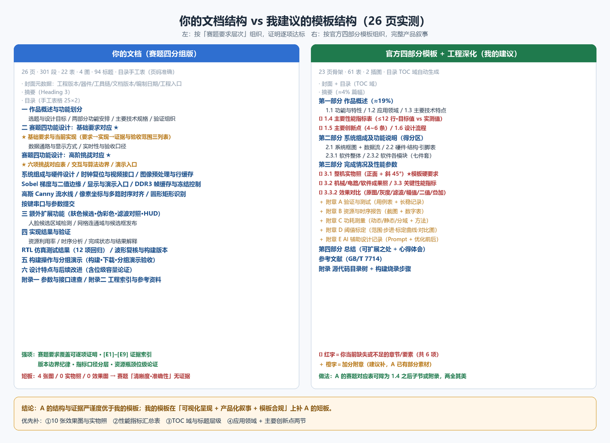

# 对比分析：你的《Ti60 实时图像边缘检测系统技术文档》 vs 我的两项交付物

**对比对象**
- **A（你的文档）**：`Ti60实时图像边缘检测系统技术文档_赛题四分组版.docx` — 26 页 / 301 段 / 22 表 / 4 图 / 94 个标题 / 文档版本 V1.2 / 编制日期 2026-09-27
- **B（我的指南）**：`技术文档可视化写作指南.md` — 四份参考文档结构分析 + 七阶段流程映射 + 逐章模板
- **C（我的骨架）**：`技术文档模板骨架-边缘检测系统（竞赛四部分+工程深化）.docx` — 23 页 / 61 表 / 2 幅插图

---

## 一、一句话结论

**A 在"结构性组织"和"证据严谨度"上明显超过我的 C 模板（也更贴合赛题评分），但在"可视化呈现"和"产品化叙事"上低于 B 指南的要求。**

具体说：A 用**赛题要求 → 当前实现 → 对应证据与验收范围**的映射表组织全文，这是 B/C 都没有给出的更好做法；A 的**证据编号体系 [E1]–[E9]、位流 SHA256、报告时间戳、口径边界声明**达到了一等奖报告没有达到的严谨度。但赛题明确"评分看**实时性、准确性、清晰度**"，而 A 全文只有 **4 张图、0 张实物照片、0 张效果图**，清晰度与准确性目前**无法被评委看见**。

---

## 二、结构对比

| 维度 | A 你的文档 | B/C 我的建议 |
|---|---|---|
| 骨架 | **六部分按"赛题要求层次"组织**：作品概述 → 赛题基础要求对应 → 高阶挑战对应 → 额外扩展 → 实现结果与验证 → 构建操作与演示 → 设计特点与后续改进 → 附录×2 | **四部分按官方模板**：作品概述 / 系统组成及功能说明 / 完成情况及性能参数 / 总结（+附章 A~E） |
| 主体权重 | 赛题功能对应 ≈ 50%，验证 ≈ 30% | 建议 §2+§3 ≈ 65% |
| 篇幅控制 | 26 页，紧凑无冗余 | 23 页骨架（含占位） |
| 图表 | **22 表 / 4 图**（图严重不足） | 22 表 / 建议 16 类图 |
| 编号索引 | **[E1]–[E9] 工程证据 + [R1]–[R5] 参考依据**，正文逐句标注 | B 仅给出"必须留证据"的清单，未给索引机制 |
| 目录 | 手工表格（章节＋页码），页码核对**准确**（26 页） | C 用 TOC 域自动生成 |

**判断**：A 的结构是**为"逐项达标证明"优化的**，B/C 的结构是**为"完整产品叙事"优化的**。两者目标不同，不是谁对谁错。

> ⚠️ 但要注意：**若赛区初赛要求提交"官方四部分模板"格式，A 的六部分结构需要二选一**——要么改回模板骨架（把赛题对应表降为 1.4 之后的子节或附录），要么在开头加一页"官方模板章节对照表"，声明每一模板章节在本文中的位置。后者成本更低且不牺牲现有结构。

---

## 三、A 比我的建议做得更好的地方（建议保留并推广）

| # | A 的做法 | 我的 B/C 对应内容 | 差距 |
|---|---|---|---|
| 1 | **"要求→实现→证据与验收范围"三列表**（表 2 基础要求、表 3 高阶挑战） | B 只说"要有需求→指标映射表" | A 把"未达标项"直接写进表（如"板载按键调阈值尚未实现"），评委一眼看到诚实度与覆盖率 |
| 2 | **证据编号体系 [E1]–[E9]**，附录二给出路径索引，正文逐条引用 | B 只列"应产出什么证据" | A 建立了**可追溯性**，比一等奖报告更强 |
| 3 | **版本边界纪律**：报告时间戳（9-25 15:16:32）、工具版本（Efinity 2025.1.110.5.9）、两份位流 SHA256 不同 → 明确"历史下载仅适用于冻结位流" | B 的自查清单只要求"记录工具版本" | A 的严谨度**超出**参考文档一个量级 |
| 4 | **延迟口径分层**：显示刷新率 60.12 Hz（按时钟×扫描参数算）/ 流水延迟 6619 拍=88.97 µs / 候选框约两帧 / **明确声明都不是端到端延迟** | B 提醒"给指标要写测量方法" | A 做到了 B 想要的效果，且更细 |
| 5 | **资源瓶颈的位级论证**：完整递归滞后连接需 720p 两位分类图 230,400 B=225 KiB，按 RAM10=10,240 bit 估需 180 块 > 余量 70 块 | B 强调"要给出位宽/容量推导"（引 AF1 的 clk_player 推导） | A 的推导**含器件结构（RAM10）与容量约束**，是本文最有说服力的段落 |
| 6 | **图题编号格式统一**为"图 N 名称"，与表 N 一致 | B 建议"图 X-Y 名称" | A 用的是全篇连续编号，同样统一；两种都合规 |
| 7 | **附录二 工程证据索引**（9 组文件清单） | B/C 只有"附录：源代码目录树" | A 更实用，可直接照搬做法 |

---

## 四、A 相对 B/C 仍缺的东西（按优先级）

### 🔴 第一优先：赛题"清晰度、准确性"目前无图可看

赛题评分三点中，A 只在文字和表格里证明了"实时性"（刷新率、延迟拍数、时序余量）。**清晰度与准确性完全没有证据载体**：

| 缺什么 | 为什么必须补 | 建议位置 |
|---|---|---|
| **整机实物照（正面 + 斜 45°）** | 官方模板提示语硬性要求；目前 0 张实物照片 | 第五部分"演示与验收"前，或新设"3.1 整机" |
| **边缘检测效果对比图**（原图/灰度/中值/高斯/Sobel幅值/二值/Canny/叠加） | 这是"准确性"的直接证据；A 有 14 种模式却一张画面都没有 | 第二、三部分每节配 1 张 |
| **阈值扫描矩阵**（低阈值 8/40/100/300 同场景并排） | 你的核心卖点之一是运行时阈值可调，必须可视化 | "Sobel 梯度与二值边缘"节 |
| **圆形/矩形识别实拍**（CIRC 品红框、RECT 绿框、NONE） | 高阶挑战 6 的验收证据 | "中央区域圆形／矩形识别"节 |
| **肤色候选框实拍**（含反例：木色物体/手臂误检） | 你已诚实说明"肤色≠人脸"，配反例图更显可信 | "人脸候选区域检测"节 |
| **串口阈值调节过程截图** | 证明"运行时调节"确实工作 | "按键串口与参数提交"节 |
| **波形/时序图** | 你已有 `wave_audit.json` 与 VCD，落成图即可 | "像素坐标与多路时序对齐"节 |

**只需补 4 张图，A 的图数就从 4 张升到 8 张，但效果图的边际收益最高。建议至少 10 张。**

### 🟠 第二优先：一页"性能指标汇总表"缺失

A 的指标散落在正文（60.12 Hz、6619 拍、16,172 XLR、72.66%、+0.302 ns、110.81 MB/s、1,012 组测试……），**没有一处集中成表**。官方模板 1.4 明确要求"主要性能指标"表。

建议补一张（≤12 行，含"设计目标值 / 实测工程值 / 测试条件"三列）：

| 项目 | 数值 | 口径与条件 |
|---|---|---|
| 有效分辨率 / 显示 | 1280×720 @ 60.12 Hz | 74.399 MHz 像素时钟 × 1650×750 扫描参数推算 |
| 存储像素格式 | RGB565（显示 RGB888） | —— |
| 统一融合算法延迟 | 6619 拍 ≈ 88.97 µs | 从 parallel_video 输入起算，不含曝光/DDR 排队/TMDS |
| 候选框帧级延迟 | 约 2 帧 | 网格采集+搜索 |
| 资源占用 | XLR 26.60% / 存储块 72.66% / DSP 8.75% / 全局时钟 43.75% | Efinity 2025.1.110.5.9，2026-09-25 15:16 route.rpt |
| 时序余量 | setup +0.302 ns / hold +0.026 ns | C4 模型，13+13 条时钟关系 |
| DDR 带宽（估算） | 110.81 MB/s（单向） | 未含刷新/命令/总线效率 |
| 回归测试 | 12 项全部 PASS | XSim，reports/contest_20260925/final_sim |
| 功耗 | **待测** | 需补测量点/供电电压/工况 |

### 🟠 第三优先：模板缺失的两节

| 缺失章节 | 官方模板位置 | 你现有素材能否支撑 |
|---|---|---|
| **应用领域** | 1.2 | 容易写：工业质检/尺寸测量前处理、教学实验平台、智能安防轮廓提取、嵌入式图像处理课程 |
| **主要创新点**（4~6 条） | 1.5 | 素材现成：①共享视频源多路并行处理 ②像素+控制信息统一对齐（40 bit 控制包）③帧级冻结不打断显示（写绕过显示槽）④中间结果全可观测（14 模式）⑤运行时可调阈值+帧边界提交 |
| 可选：机械/结构装配 | 2.2.2 | 可写摄像头支架、镜头视场角与目标距离、按键复用引脚的接线约束（你已提到"不得同时连接并行 LCD"，是很好的接口约束说明） |

### 🟡 第四优先：目录与标题层级（低成本高收益）

| 问题 | 证据 | 修法 |
|---|---|---|
| **目录不是自动生成的** | document.xml 中 `w:instrText` 出现 0 次，无 TOC 域 | 改成 TOC 域（引用→目录），并在正文只用一套标题样式 |
| 页码目前准确 | 手工表页码与渲染结果一致（26 页） | 但**任何一次正文改动都会让页码失效**，务必改自动目录 |
| **"摘要"用了 Heading 3**，"目录"用了 Heading 1 | 标题层级统计：Title 1 / H1 24 / H2 68 / **H3 只有 1 个（正是"摘要"）** | 摘要改为独立样式或 H1；"目录"不参与编号 |
| **"参考文献"不是 Heading 1** | 94 个标题里没有"参考文献"条目（[R1]–[R5] 在附录二内） | 若沿用官方模板，单列"参考文献"章；若沿用现结构，至少让附录二标题进目录 |
| 表格右侧列有时溢出正文宽度 | 22 张表，部分 3 列表在渲染中被右边界裁切 | 固定表格布局 + 显式列宽（我在 C 里踩过同一个坑） |

---

## 五、口径与事实复核（我逐条核对了一遍，只有两处建议）

| 你的数据 | 复核结果 |
|---|---|
| 像素时钟 74.399 MHz；1650×750 扫描；刷新率 60.12 Hz | 74.399e6/(1650×750) = **60.12 Hz** ✓ 自洽 |
| 延迟 6619 拍 → 88.97 µs | 6619/74.399e6 = **88.97 µs** ✓ |
| D = 4×(1650+1)+14 = 6618 拍 | 4×1651 = 6604，+14 = **6618** ✓ |
| DDR 带宽 110.81 MB/s | 1280×720×2 B×60.12 Hz = **110.81 MB/s** ✓ |
| 单帧 1,843,200 B ≈ 1.758 MiB | 1843200/1048576 = **1.7578 MiB** ✓ |
| 4 帧槽 × 4 MiB = 16 MiB | 0x00000000/0x00400000/0x00800000/0x00C00000 ✓ 每槽 2²² B |
| 网格 160×90 = 14,400 单元 | 1280/8 × 720/8 = **14,400** ✓ |
| 720p 一位分类图 230,400 B = 225 KiB；RAM10 需 180 块 | 1280×720/4 = 230,400 B ✓；230400×8 bit÷10240 bit = **180** ✓（估算口径已声明） |
| 全前景搜索 443,411 拍 ≈ 5.96 ms < 一帧 1,237,500 拍 | 443411/74.399e6 = **5.96 ms** ✓；1650×750 = **1,237,500** ✓ |
| 资源：16,172/60,800 = 26.60%；186/256 = 72.66%；14/160 = 8.75%；14/32 = 43.75% | 全部 ✓ |
| 串口阈值范围：低 8–1000、高 16–2000（+8/+16 步进） | 8→1000 需 +124 档、16→2000 需 +124 档，**步数一致** ✓ 设计自洽 |
| 位流哈希拆两行书写 | 78f2279…（64 hex）与 edbc762…（64 hex）各 64 位 ✓ |

**两处建议**
1. **"显示刷新率 60.12 Hz"与"帧率"要始终分栏表述**——你已经做了（"不代表摄像头实测帧率"），但摘要第一处容易被评委读成实测帧率，建议在指标表里直接写"显示刷新率（推算）"。
2. **FPGA 引脚约束的正确性**：K1 用 N2/GPIOL_P_02、K2 用 M2/GPIOL_N_02，你已注明"复用闲置并行 LCD 控制引脚、此版本不得同时连接并行 LCD" —— 这条约束务必在"外设连接要点"用**加粗或提示框**突出，否则演示现场一插并行 LCD 就出故障。

---

## 六、给你的最小行动清单（按投入产出排序）

| 顺序 | 动作 | 预计成本 | 收益 |
|---|---|---|---|
| 1 | 补 **10 张效果图与实物照**（含阈值扫描矩阵、形状识别实拍、肤色候选+反例） | 1 天（拍照+整理） | 🔥 直接对应赛题"清晰度/准确性"，最高 |
| 2 | 加 **1 页性能指标汇总表**（含"功耗待测"如实标注） | 1 小时 | 🔥 补齐模板 1.4 硬性要求 |
| 3 | 目录改为 **TOC 域**；摘要改 H1；参考文献独立成章 | 30 分钟 | 高（页码不失效、层级规范） |
| 4 | 补 **应用领域** + **主要创新点** 两节（素材已在文中） | 2 小时 | 高（补齐模板 1.1/1.2/1.5） |
| 5 | 开头加一页 **"官方模板章节对照表"**（若要按四部分模板提交） | 30 分钟 | 中（结构合规性兜底） |
| 6 | 补 **功耗实测**（万用表/功耗计，记录工况与仪表） | 半天 | 中（附录 C 唯一空白） |
| 7 | 补 **端到端延迟与丢帧率** 实测（示波器/高速相机计时 + 长稳记录） | 1 天 | 中高（把"推算"升级为"实测"） |
| 8 | 固定表格列宽，消除右侧裁切 | 1 小时 | 低但显专业 |

---

## 七、可以互相改进的两点

**A 可以吸收 B/C 的**：
1. "产品化叙事"章节顺序（功能与特性 → 应用领域 → 技术特点 → 指标 → 创新点 → 设计流程），让非本专业评委在 10 秒内建立"结构—功能—性能"认知；
2. 图的密度与"一图一主张 + 图上带参数"规范；
3. 自动目录与统一编号。

**B/C 应当吸收 A 的**（我已同步进指南）：
1. **[E]/[R] 证据编号体系**；
2. **"要求→实现→证据与验收范围"三列表**（对竞赛文档价值极高）；
3. **版本边界纪律**（报告时间戳 + 工具版本 + 位流哈希 + "历史记录仅适用于匹配位流"）；
4. **指标口径分层声明**（推算值 / 算法流水值 / 帧级值 / 端到端值 分开写）；
5. **资源瓶颈的位级容量论证**。

---

*本对比基于对 A 文档全文（301 段、22 表、4 图、94 标题）的提取与 26 页 PDF 渲染核对，所有数值均已按原文复算。*
