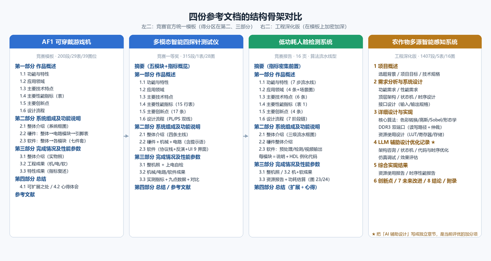
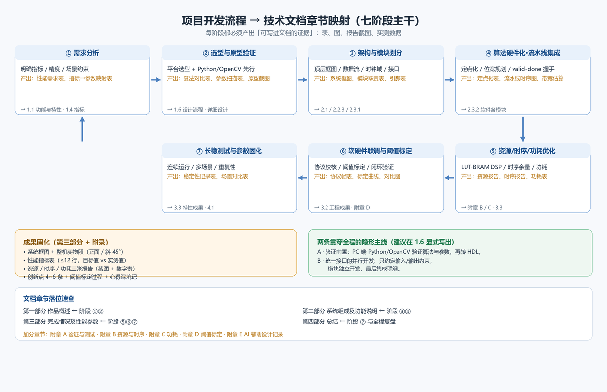

# 技术文档可视化写作指南

**基于四份参考文档的结构分析，面向「基于 FPGA 的实时图像边缘检测系统」（易灵思 VF-Ti60F225 / Efinity）**

> **参考文档（本次分析对象）**
> 1. 《农作物多源智能感知与实时诊断系统》—— `最终版本农作物.docx`（1407 段 / 5 表 / 16 图 / 416 行代码）
> 2. 《AF1 可穿戴游戏机技术文档》—— `AF1游戏机技术文档.docx`（200 段 / 29 表 / 39 图位）
> 3. 《多模态智能四探针半导体测试仪》—— 2025 嵌入式 FPGA 创新设计赛（安路科技杯）全国一等奖初赛报告（315 段 / 28 图）
> 4. 《低功耗人脸检测系统》—— `低功耗人脸检测报告.pdf`（16 页，**与你的项目同平台同数据流，重点参考**）
>
> **你的项目**：`Efinity-Project / 10.11 guo Canny_threshold_full_project`（GitHub）
> ⚠️ 本机网络策略禁止访问 github.com（域名被解析为非公网地址），因此本指南未读取你的仓库源码；文中模块名/参数名以「⚠️按实际代码修改」标注，请对照工程目录逐一替换。

---

## 〇、先看结论：这套文档该怎么写

| 结论 | 依据 |
|---|---|
| **骨架用竞赛模板四部分，内容按工程文档密度填** | 三份竞赛报告共用同一官方模板；《农作物》是同一模板的工程深化版 |
| **你的项目有"标准答案"可对标** | 《低功耗人脸检测系统》用的就是 Ti60F225 + MIPI 摄像头 + DDR3 + HDMI，数据流与你几乎一致，可直接对标其章节与指标写法 |
| **主体篇幅必须压在第二部分+第三部分（≈65%）** | 一等奖报告的实测篇幅比例：§2+§3 ≈ 65%，§1 ≈ 19%，摘要 ≈ 4%，§4 ≈ 8% |
| **评分三要素要能被"看见"** | 赛题明确的评分点是**实时性、准确性、清晰度**——分别对应第三部分的帧率/延迟、阈值与误差、边缘效果对比图 |
| **四个必须补齐的短板** | 资源表、时序报告、测量方法、阈值标定过程（四份参考文档全部缺失或半缺失，是拉开差距的地方） |

---

## 一、四份参考文档的结构对比



| 维度 | 农作物（工程深化版） | AF1 游戏机 | 四探针（一等奖） | 人脸检测（同平台对标） |
|---|---|---|---|---|
| 骨架 | 项目概述→需求分析与系统设计→详细设计与实现→**LLM 辅助设计优化记录**→综合实现结果→创新点→未来改进→结论→参考文献→附录 | 作品概述→系统组成及功能说明→完成情况及性能参数→总结→参考文献 | 同左 | 同左 |
| 段落 / 表 / 图 | 1407 / 5 / 16 | 200 / 29 / 39 | 315 / 1 / 28 | 16 页 / 2 表 / 24 图 |
| 图表重心 | 架构图、状态机、时序图、资源报告、源代码目录树 | 结构框图、引脚分配表、变量含义表、代码截图 | 系统框图、硬件连接图、UI 截图、热力图 | **HDL 例化代码块 + 工具报告截图 + 流水线框图** |
| 代码呈现 | 416 行集中在优化章节（占 31%） | 全部以截图占位 | 无 | **每个模块一段例化代码 + 一句作用说明** |
| 缺陷（可反推规则） | 第 4 章占 66.8%，"设计—结果"主干被 LLM 记录淹没；第 3 章几乎无 RTL | **29 表里 25 表是图片占位**；无资源/时序报告；指标无测量方法 | 公式字体丢失吞掉 `16 位`/`0.1 mV`/`±0.01 mm`；编号双轨导致无目录 | 无资源数字表（仅截图）；无功耗测量方法 |

**核心判断**：**比赛报告的得分区是"第二部分 + 第三部分"，不是"作品概述"。** 概述只写 19%，把篇幅留给模块设计与实测结果。

---

## 二、竞赛报告模板骨架（原文级别，直接照抄标题）

```
封面（作品名 + 副标题 + 团队/日期）
摘要（≈4% 篇幅：一段背景 + 一段核心流程与指标 + 一段价值）

第一部分  作品概述                                    ← ≈19%
  1.1 功能与特性      —— 设备做什么（分条，每条＝能力＋机理＋量化）
  1.2 应用领域        —— 面向谁（分条 + 场景图）
  1.3 主要技术特点    —— 怎么做到（架构/算法/低功耗/国产化）
  1.4 主要性能指标    —— 表格：项目 | 技术指标 | 说明（≤12 行）
  1.5 主要创新点      —— 分条：技术名词＋机理＋收益
  1.6 设计流程        —— 流程图 + 七阶段流程链

第二部分  系统组成及功能说明                          ← 得分区（与第三部分合计 ≈65%）
  2.1 整体介绍        —— 系统框图（分层着色）+ 数据流一句话 + 模块职责清单
  2.2 硬件系统介绍
      2.2.1 硬件整体介绍
      2.2.2 机械设计介绍（无机械结构可写"成像与显示装配"）
      2.2.3 电路各模块介绍 ★提示语：从总体到局部，逐级给出各模块的具体设计图，并标记信号名
  2.3 软件系统介绍
      2.3.1 软件整体介绍
      2.3.2 软件各模块介绍 ★提示语：根据总体框图，给出各模块的具体设计说明。
                              从顶层到底层逐次给出各函数的流程图及其关键输入、输出变量

第三部分  完成情况及性能参数
  3.1 整体介绍        ★提示语：整个系统实物的正面、斜 45° 全局性照片
  3.2 工程成果        ★提示语：分硬件实物、软件界面等设计结果（3.2.1 机械/3.2.2 电路/3.2.3 软件）
  3.3 特性成果        ★提示语：逐个展示功能、性能参数等量化指标（实测/工程值）
      3.3.1 关键性能指标（实测/工程值）
      3.3.2 效果对比与优势分析

第四部分  总结
  4.1 可扩展之处      —— 分条：算法层/系统层/接口层/场景层
  4.2 心得体会        —— 方法论 + 踩坑与解决 + 能力成长

参考文献（GB/T 7714 风格，正文必须有引用标注）
```

**★ 提示语＝评分点**：官方报告把编者要求**直接写在标题里**，这些就是评委的检查项。写作时把标题里的括号内容当作验收标准逐条对齐。

### 2.1 建议增加的工程深化章节（放在第三部分之后、总结之前）

| 章节 | 为什么加 | 内容模板 |
|---|---|---|
| **附章 A：验证与测试** | 四份参考文档全部缺失，是最大空白 | 测试环境表（板卡/摄像头/显示器/仪器/固件版本）、测试用例表（场景×输入×期望×实测）、边界与异常测试、连续运行 ≥2 h 稳定性记录 |
| **附章 B：资源与时序报告** | 一等奖报告的硬门槛，只写"实现了"会被扣分 | 资源表（LUT/FF/BRAM/DSP/PLL/IO 已用/总量/占比）、时序表（时钟名\|约束\|实测 Fmax\|WNS\|裕量）、关键路径说明 |
| **附章 C：功耗测量** | 同平台主打卖点（人脸检测做到了 0.5848 W） | 功耗表（动态/静态/总计）、测量方法（功耗估算工具 + 万用表实测值）、供电域电流 |
| **附章 D：关键参数与阈值标定** | **你的项目核心卖点就是"阈值可调"**，必须写清标定过程 | 阈值含义、可调范围、步进、调整方式（按键/串口/上位机）、标定曲线、不同阈值下的效果对比图矩阵 |
| **附章 E：LLM / AI 辅助设计记录** | 《农作物》用它撑起一个章节 | 五段闭环：优化目标→完整 Prompt（含器件型号与量化指标）→模型回答要点→采纳与实施（**含未采纳项**）→量化结果 |
| 附录 | 提升可复现性 | 源代码目录树、构建与烧录步骤、Efinity 工程版本、引脚约束摘要 |

### 2.2 从实际项目文档反哺的四条写法（已验证有效，强烈建议采用）

以下四条来自对《Ti60 实时图像边缘检测系统技术文档》（26 页 / 22 表，按"赛题要求层次"组织）的对照分析，其证据严谨度**超过四份参考文档**，已并入本指南：

| 做法 | 具体形式 | 为什么有效 |
|---|---|---|
| **① 证据编号体系** | 正文逐句标注 `[E1]`–`[E9]`，附录给出每个编号对应的文件路径清单；另有 `[R1]`–`[R5]` 标注参考依据 | 任何一句结论都能回溯到文件；评委可自行核对，是可信度的放大器 |
| **② "要求 → 实现 → 证据与验收范围"三列表** | 逐条列出赛题/需求要求，第二列写当前实现，第三列写**对应证据 + 尚未完成的部分** | 把"逐项达标"变成可打勾的表；未达标项如实入表，反而显得专业 |
| **③ 版本边界纪律** | 报告写明工具版本（如 Efinity 2025.1.110.5.9）与生成时间戳；两份位流各附 SHA256，并说明"历史下载记录仅适用于其匹配的冻结位流" | 避免把不同版本的结果混写成同一实测指标，是评审最容易挑出的漏洞 |
| **④ 指标口径分层声明** | 显示刷新率（按时钟×扫描参数推算）/ 算法流水延迟（拍数→µs）/ 帧级延迟（约 2 帧）/ 端到端延迟（待测）**分四行写清**，并逐条注明"不是端到端延迟" | 一个数字一个口径，杜绝"用推算值冒充实测值"的质疑 |

**⑤ 资源瓶颈的位级容量论证**（写法范例，值得逐字学）
> 完整递归滞后连接需保留像素级弱边连通分量：720p 两位分类图为 1280×720÷4 = 230,400 B = 225 KiB；按每块 RAM10 为 10,240 bit 的理想容量估计需 180 块，尚未计入队列、端口和打包损耗，已超过当前 70 块的余量 → 故改用局部八邻域连接。
→ 这种"需求 → 位宽/容量计算 → 与器件余量对比 → 得出设计取舍"的链条，比任何形容词都有说服力。

---

## 三、项目开发流程 → 文档章节映射（七阶段主干）



| 阶段 | 主要活动 | 必须留下的"证据" | 落位章节 |
|---|---|---|---|
| ① 需求分析 | 明确分辨率/帧率/延迟/资源上限；**把赛题的"实时性、准确性、清晰度"翻译成数值** | 性能需求表（含设计目标值与验收阈值） | 1.1 / 1.4 |
| ② 技术选型与原型验证 | Efinity 工具链与 IP 选型；**Python/OpenCV 先验证 Canny 与阈值策略** | 算法对比表（Sobel vs Canny、阈值组合扫描）、原型截图 | 1.6 / 2.3 |
| ③ 架构与模块划分 | 顶层框图、数据流、时钟域（像素时钟/系统时钟/DDR 时钟）、接口定义 | 系统框图、模块职责表、引脚与接口表 | 2.1 / 2.2.3 / 2.3.1 |
| ④ 算法硬件化与流水线集成 | 灰度化→高斯→Sobel 梯度→非极大值抑制→双阈值+滞后连接；定点化与位宽规划；line buffer 与 valid/done 握手 | 定点化表、流水线级数与延迟拍数、BRAM 用量估算 | 2.3.2 |
| ⑤ 资源/时序/功耗优化 | LUT/BRAM/DSP 收敛、时序余量、功耗估算 | 资源报告、时序报告、功耗表截图与数字 | 附章 B / C / 3.3 |
| ⑥ 联调与标定 | 摄像头→处理→HDMI 全链路；**阈值标定与上位机/按键交互**；串口上报 | 协议帧表、标定曲线、各阈值效果对比图 | 3.2 / 附章 D |
| ⑦ 长稳测试与参数固化 | 连续运行、不同光照/场景鲁棒性、参数固化 | 稳定性记录表、场景对比表 | 3.3 / 4.1 |

**两条贯穿全程的隐形主线（建议显式写进 1.6 设计流程）**
- **主线 A · 验证前置**：先在 PC 端用 Python/OpenCV 跑通 Canny 与阈值策略，再转 Verilog——人脸检测文档总结为"软件验证先行、硬件优化跟进"，并写明"Python 几乎不受存储限制，而 FPGA 需严格受控 BRAM"，这就是你写"为什么改成流式"的最佳论据。
- **主线 B · 统一接口的模块化并行开发**：围绕统一接口（位宽 + valid/done）独立开发模块，只约定输入输出约束即可完成功能，最后集成。

---

## 四、逐章模板（已填入边缘检测项目内容）

> 模块名以 `⚠️` 标注处请对照你的工程替换（如 `canny_top`、`gauss_filter`、`sobel_grad`、`nms_3x3`、`double_threshold`、`hysteresis_link`、`line_buffer`、`rgb2gray`）。

### 摘要（4% 篇幅，三段式）
> **段 1（背景+方案）**：本作品面向工业检测、医学影像与自动驾驶等对实时性要求高的场景，基于易灵思（Elitestek）钛金 Ti60F225 FPGA 设计并实现了实时图像边缘检测系统。系统采用"全硬件流水线 + 可调双阈值"架构，以低延迟、低功耗、强并行满足长期在线运行需求；无需通用处理器与软件图像库，即可完成 1280×720@60 FPS 的逐像素边缘提取与实时显示。
> **段 2（核心流程+指标）**：核心流程包括：RGB 转灰度、5×5 高斯平滑、Sobel 梯度计算、非极大值抑制、双阈值判定与滞后边缘连接、边缘叠加输出。系统支持 1280×720@60 FPS 实时显示；端到端流水线延迟 ≤ ⚠️__ 行；典型资源占用 LUT ⚠️__%、BRAM ⚠️__ 块、DSP ⚠️__ 个；整板功耗约 ⚠️__ W。
> **段 3（价值）**：本作品充分发挥 FPGA 的并行与低功耗优势，为智慧工业与智能安防等需要实时轮廓提取的场景提供一套低功耗、低延迟、高可靠、可国产化替代的解决方案。

### 1.1 功能与特性（分条，6~7 条）
1. **实时边缘检测**：基于 Ti60F225 FPGA 实现实时图像边缘检测，支持 1280×720@60 fps，采用全硬件流水线架构。
2. 处理流程：`1) RGB→灰度 → 2) 5×5 高斯平滑 → 3) Sobel 梯度与幅值/方向 → 4) 非极大值抑制 → 5) 双阈值判定 → 6) 滞后边缘连接 → 7) 边缘叠加/二值输出`。
3. **阈值可调**：双阈值支持 ⚠️按键/串口指令/上位机 在线调节，高阈值范围 ⚠️ 0~255、步进 1，低阈值＝高阈值×⚠️ 比例系数。
4. **多模式输出**：原图 / 边缘图 / 叠加图 三种画面可切换（对应"清晰度"评分项）。
5. **参数上报**：串口实时上报帧率、检测到的边缘像素数、当前阈值，便于标定与演示。
6. **低功耗与小体积**：全链路单片 FPGA 完成，无外部处理器与 DDR 高带宽依赖（检测链路）。
7. **可移植性**：参数化设计（`WIDTH`/`HEIGHT`/阈值位宽），可快速适配其他分辨率与摄像头模组。

### 1.2 应用领域（分条 + 1 张场景图）
- 工业视觉检测：零件轮廓、缺陷边缘、尺寸测量前处理；
- 医疗影像分析：病灶边界增强与轮廓提取；
- 智能交通与安防：车道线、行人轮廓、目标区域分割前处理；
- 教学与科研：数字图像处理与 FPGA 流水线设计的综合实验平台。

### 1.3 主要技术特点（每条＝名词化小标题 + 方案 + 量化结果）
1. **全流水线硬件架构**：7 级流水、逐像素处理，无整帧缓存（除显示通路），延迟固定且可预测。
2. **流式行缓存设计**：5×5 窗口仅用 ⚠️4 条 line buffer（BRAM ⚠️__ 块），相较整帧缓存方案内存占用由 ⚠️__ KB 降至 ⚠️__ KB。
3. **硬件友好数值**：梯度幅值用 `|Gx|+|Gy|` 近似欧氏距离（免开方）；方向量化到 4 个区间（免浮点 atan）。
4. **可调阈值机制**：双阈值在线可调并支持"预设档位"一键切换，适应不同光照。
5. **低功耗**：检测链路单遍流式、避免外部存储高带宽访问，整板功耗 ⚠️__ W。
6. **国产化支持**：基于国产 FPGA 平台（易灵思）与 Efinity 工具链，提供全栈国产化可替代路径。

### 1.4 主要性能指标（表格，≤12 行）

| 项目 | 技术指标 | 说明 |
|---|---|---|
| 图像分辨率（像素） | 1280×720 | 可按参数化设计调整 |
| 图像显示帧率（FPS） | 60 | HDMI 输出 |
| 边缘检测速度（FPS） | ⚠️ 52–57 | 流水线吞吐，与显示同源 |
| 端到端处理延迟 | ⚠️ ≤ __ 行 / __ µs | 流水线级数 × 像素时钟周期 |
| 阈值调节范围 | 高阈值 0–255，步进 1 | 低阈值＝高阈值×比例系数 |
| 梯度幅值精度 | 定点 ⚠️__ bit | \|Gx\|+\|Gy\| 近似，误差 ≤ ⚠️__% |
| 资源占用 | LUT ⚠️__ / BRAM ⚠️__ / DSP ⚠️__ | Efinity 综合报告 |
| 时序 | Fmax ⚠️__ MHz，WNS ⚠️__ ns | 目标时钟 ⚠️__ MHz |
| 整板功耗 | ⚠️__ W（动态+静态） | Efinity Power Estimator + 实测 |
| 连续运行稳定性 | ≥ 2 h 无异常 | 长稳测试记录 |

### 1.5 主要创新点（4~6 条，每条＝技术名词＋机理＋收益）
1. **流式全流水线边缘检测架构**：单遍扫描、仅保留行缓存，无整帧缓存，实现真正的低延迟检测链路。
2. **硬件友好的双阈值滞后连接**：以行级标签状态机实现边缘连接，避免二次遍历图像。
3. **梯度计算定点化优化**：以移位加法实现 ⚠️×0.299/0.587/0.114 灰度权重，以 \|Gx\|+\|Gy\| 替代开方，兼顾精度与时序。
4. **在线阈值标定机制**：支持运行中调节双阈值并即时观察效果，解决固定阈值在不同光照下适应性差的问题。
5. **多模式可视化输出**：原图/边缘/叠加三视图切换，直观展示算法各阶段效果。

### 1.6 设计流程（一段话流程链 + 流程图）
> 需求分析（实时性/准确性/清晰度指标化）→ 技术选型与 Python/OpenCV 原型验证（Canny 与阈值策略参数扫描）→ 算法硬件化（灰度化、高斯、Sobel、NMS、双阈值与滞后连接）→ 模块开发与流水线集成（统一 valid/done 接口）→ 资源/时序/功耗优化 → 多人脸⚠️多场景联调与阈值标定 → 场景化长稳测试与参数固化。
（把 ⚠️ 处替换为"多场景"；并配一张横向七段流程图 `图 1-1 设计流程图`。）

### 2.1 整体介绍（系统框图 + 一句话数据流）
> **数据流**：摄像头采集 → 预处理（Bayer→RGB、白平衡、裁剪）→ 灰度化 → 高斯平滑 → Sobel 梯度 → 非极大值抑制 → 双阈值判定 → 滞后连接 → 边缘叠加 → HDMI 输出。
> **模块流式连接**，实现低延迟、低功耗的 1280×720@60 FPS 实时显示与高帧率边缘检测。

> **可对标图**：人脸检测报告 `图 4-数据采集模块信号`——三层分区着色（图像采集与预处理 / 人脸检测处理 / 视频输出），每层内画模块方框与箭头，箭头旁标注数据格式（RGB 图像、标注图像）。你的框图把中间层换成"边缘检测处理模块"，方框换成灰度化/高斯/Sobel/NMS/双阈值/滞后连接即可。

### 2.2.3 电路各模块介绍（★从总体到局部，逐级给出设计图并标记信号名）
必须包含：① 平台清单（Ti60F225 开发板、⚠️SC1336/OV5640 摄像头 MIPI-CSI、DDR3、HDMI 输出）；② **引脚分配表**（四列，末两行固定 VCC/GND）：

| FPGA 引脚 | 信号名称 | 连接模块 | 模块引脚说明 |
|---|---|---|---|
| ⚠️__ | cam_pclk | 摄像头 MIPI-CSI | 像素时钟 |
| ⚠️__ | cam_vsync | 摄像头 | 帧同步 |
| ⚠️__ | cam_data[7:0] | 摄像头 | 像素数据 |
| ⚠️__ | hdmi_tx_d[23:0] | HDMI 发送 | 像素数据位 |
| ⚠️__ | uart_rx / uart_tx | 上位机串口 | 阈值下发 / 状态上报 |
| 3.3V | VCC | 公共供电 | —— |
| GND | GND | 公共地 | —— |

### 2.3.2 软件各模块介绍（固定六要素，逐模块复制）
**每个模块按此顺序写**（这是四份文档中一致性最高、最值得复制的结构，下称"七件套"）：

1. **作用与位置**：一句话定位 + 在总框图中的层级（顶层文件是哪个）
2. **文件清单**：模块名后紧跟括号列出 `.v/.sv` 文件
3. **结构/流水线框图**：画内部子模块与数据流
4. **端口/变量表**（两列或四列）：`信号名称 | 位宽 | 方向 | 含义`
5. **流程或状态机**：箭头串状态，**每个迁移标注触发条件、计数器阈值与超时**
6. **关键参数与代码**：关键常量（窗口尺寸、阈值位宽、系数）+ ≤15 行核心代码
7. **量化结论**：本模块带来的延迟/资源/精度代价

**模块清单（框架示例，⚠️按实际代码替换）**
| 模块 | 六要素要点 |
|---|---|
| `rgb2gray` ⚠️ | 权重（0.299/0.587/0.114）移位加法实现；输出 8 bit 灰度 |
| `gauss_5x5` ⚠️ | 5×5 核分解为两次一维卷积；行缓存数量与 BRAM 占用；边界处理策略 |
| `sobel_grad` ⚠️ | Gx/Gy 卷积、幅值 \|Gx\|+\|Gy\|、方向量化 4 区间；DSP 占用 |
| `nms` ⚠️ | 沿梯度方向三点比较；位宽与符号处理 |
| `double_threshold` ⚠️ | 高/低阈值比较，输出强/弱/非边缘三类标签；**阈值来源（寄存器/串口）** |
| `hysteresis_link` ⚠️ | 行级状态机或 8 邻域窗口；弱边缘连接策略与延迟 |
| `line_buffer` ⚠️ | 存储方案（BRAM/移位寄存器）、容量计算过程 |
| `edge_overlay` ⚠️ | 边缘像素着色、与原图叠加逻辑 |
| `hdmi_out` ⚠️ | 时序发生器（720p 参数）、rgb2dvi IP 例化 |
| `uart_cmd` ⚠️ | 帧格式（帧头\|命令\|数据\|校验\|帧尾）、指令语义与阈值映射 |

### 3.3 特性成果（评分三要素 → 三张图 + 一张表）
- **实时性**：串口上报帧率截图（如 `帧率：58 FPS`）+ 延迟计算说明；
- **准确性**：阈值扫描矩阵图（同一场景 4~6 组阈值的效果并排）+ 与 PC 端 OpenCV 结果的对比；
- **清晰度**：实拍边缘效果图（多场景：室内/室外/弱光/高对比）+ 局部放大对比；
- **资源/时序/功耗**：三张工具报告截图 + 数字表格（**不要只放截图，必须把关键数字抄成表**）。

---

## 五、句子级写作范式（可直接套用）

| 场景 | 范式 | 出处 |
|---|---|---|
| 指标表述 | `指标名：数值 + 单位（测试条件/标准器）`，误差必须括注量程段 | 一等奖报告"用硅标样片 0.01–50 Ω·cm 测试 ≤±5%" |
| 技术手段+收益 | `通过<手段>，将<指标>压缩至<数值>以内` | AF1"将指令端到端传输延时压缩至 50 ms 以内" |
| 表后收口 | 表格后紧跟一句定性结论 | AF1"经整机测试……满足可穿戴体感游戏的运行需求" |
| 创新点 | `技术名词：怎么做的，带来什么` | 人脸检测"流式连通组件分析算法：单遍扫描、仅两行标签缓存，大幅降低 BRAM 消耗" |
| 优化叙事 | `现象(数据) → 根因 → N 条编号措施 → 结果(数据) → 闭环说明` | 农作物"WNS −0.37 ns(5.37 vs 5.00) → 组合锥过深+高扇出 → 6 条措施 → WNS +0.28 ns，Fmax≈205–208 MHz" |
| 踩坑复盘 | `起初采用 X，问题 Y；改为 Z，收益 A（量化）` | 人脸检测"起初尝试帧缓存方案导致资源吃紧……随后改为单遍流式，仅保留两行像素标签，显著降低了内存需求" |
| 目标 vs 实测 | 两列式对比表：`指标 \| 目标值 \| 实测值 \| 裕量`，**未达标项如实保留** | 农作物表3/表4（如实写出 89%、43 m、59 W 未达标） |

**"为什么这样优化"的论证范式**（AF1 是四份文档中唯一给出数值推导的段落，务必学）
> 26 位变量 `clk_player` 用于调控移动速度：输入时钟 50 MHz 时每次加 16，26 位最大值 67108864，每秒累加 5×10⁶ 次……设定累积大于 67108844 才执行移动指令，从而把速度控制在合理范围。
→ 你的项目可对应写：**为什么选 5×5 高斯而非 3×3**、**为什么用 \|Gx\|+\|Gy\| 而非开方**、**行缓存为什么是 4 条**，都要给出位宽/容量/误差的数字推导。

---

## 六、可视化规范

### 6.1 图表编号与引用（硬规则）
- 统一 `图 <章>-<序号> <名称>`、`表 <章>-<序号> <名称>`，如 `图 2-4 边缘检测流水线结构`；
- **图题在图下方、表题在表上方**；
- 正文必须出现"如图 x-y 所示"的引用句；
- 禁止用小节号作图题（一等奖报告出现 `3.3.1 产品UI界面` 这类图题，是明显缺陷）；
- 一图一主张，**图内必须带关键参数**（分辨率、时钟、位宽、阈值）。

### 6.2 这套项目需要的图（按优先级）

| 优先级 | 图 | 内容要素 | 落位 |
|---|---|---|---|
| ★★★ | 系统整体框图 | 三层分区着色 + 层内模块 + 箭头标数据格式 | 2.1 |
| ★★★ | 边缘检测流水线结构图 | 7 级串联，每级标"输入→输出"、位宽、延迟拍数 | 2.3.2 |
| ★★★ | 效果对比图 | 原图 / 灰度 / 高斯后 / 梯度幅值 / NMS 后 / 二值边缘 / 叠加（7 联图或 2×4） | 3.3 |
| ★★★ | 阈值扫描矩阵图 | 同一场景 3×2 或 2×3 组阈值效果并排 + 标注阈值 | 附章 D |
| ★★☆ | 算法流程图 | 从采集到 HDMI 的完整判定流程（含阈值分支） | 1.6 / 2.3.2 |
| ★★☆ | 硬件连接图 | 器件 + 接口协议 + 引脚标注（摄像头/HDMI/串口/电源） | 2.2.3 |
| ★★☆ | 时钟域与复位图 | 像素时钟/系统时钟/DDR 时钟、跨域握手方式 | 2.3.1 / 附章 B |
| ★★☆ | 时序/波形图 | valid/done 握手、帧同步、行缓存读写时序、关键延迟拍数 | 2.3.2 / 附章 B |
| ★★☆ | 资源使用表 | 资源 \| 已用 \| 总量 \| 占比（LUT/FF/BRAM/DSP/PLL/IO） | 附章 B |
| ★★☆ | 时序报告 | 时钟 \| 约束 \| 实测 \| WNS \| 裕量 | 附章 B |
| ★☆☆ | 定点化位宽表 | 变量 \| Q 格式 \| 动态范围 \| 精度损失 | 2.3.2 |
| ★☆☆ | 状态机图 | 滞后连接的连接状态机（圆圈 + 迁移条件 + 计数器阈值） | 2.3.2 |
| ★☆☆ | 参数交互图 | 阈值从按键/串口/上位机到寄存器的路径 | 附章 D |
| ★☆☆ | 整机实物照 | 正面 + 斜 45°（★模板硬性要求） | 3.1 |
| ★☆☆ | 功耗构成图 | 动态/静态、分域电流 | 附章 C |
| ★☆☆ | 收敛趋势图 | 优化迭代轮次 vs 资源占用/时钟频率 | 附章 B/E |

### 6.3 制图规范
- 同实体固定配色（同一模块在图 1/图 4/图 7 中用同色）；
- 中文标注统一字体（微软雅黑/思源黑体），字号不小于 9 pt（缩放后仍可读）；
- 框图箭头必须标明**数据格式与位宽**（RGB888、8 bit 灰度、1 bit 边缘）；
- 照片类图加标注箭头/文字框，指出关键部件。

---

## 七、定稿自查清单

**结构**
- [ ] 严格四部分骨架，编号只用一套（不要"章标题"自定义样式与 Heading 自动编号混用）；
- [ ] 无空标题、无残留编者提示语（如"（实物照片）""阐述最终实现的成果"）；
- [ ] 2.1/2.2/2.3/3.1/3.2/3.3 手写编号与自动编号一致；
- [ ] 自动生成目录，页码正确。

**内容**
- [ ] §2+§3 占全文 ≈65%；
- [ ] 每个模块都有：作用 → 框图 → 端口/变量表 → 流程 → 代码 → 参数 → 量化结论；
- [ ] 每个指标都写清**测量方法**（仪器、条件、量程段、重复次数）；
- [ ] 同一指标全文一个口径（避免出现"0.1 mV / 0.15258789 mV / 10⁻² mV"三套写法）；
- [ ] 目标值 vs 实测值对照表，未达标项如实保留并说明原因；
- [ ] 关键数字用**纯文本**书写（公式域/特殊字体已在本批文档中吞掉 `16 位`、`0.1 mV`、`±0.01 mm`）；
- [ ] 创新点与技术特点不重复（AF1 中两节近乎重复，是扣分点）；
- [ ] 参考文献 ≥6 篇且在正文有引用标注。

**图表**
- [ ] 全文统一编号，图题在下、表题在上，每图都有正文引用；
- [ ] 资源/时序/功耗**既有截图又有数字表**；
- [ ] 效果图含多场景与局部放大；
- [ ] 整机实物照含正面 + 斜 45°。

**加分项**
- [ ] 附章 A 验证与测试（测试用例表 + 长稳记录）；
- [ ] 附章 D 阈值标定过程（可调范围、步进、标定曲线）；
- [ ] 附章 E LLM 辅助设计记录（Prompt + 优化前后对比 + 量化结果）；
- [ ] 附录含源代码目录树与构建/烧录步骤（提升可复现性）。
- [ ] **正文标注 `[E#]` 证据编号，附录给出编号→文件路径索引**；
- [ ] **工具版本 + 报告生成时间戳 + 位流 SHA256**，并声明"历史下载记录仅适用于匹配位流"；
- [ ] **指标口径分层**：推算值 / 算法流水值 / 帧级值 / 端到端值分开写，每条注明测量边界。

---

## 七之二、结构选择：官方模板 vs 要求层次组织

若你的项目是按**赛题要求层次**（如"基础要求 / 高阶挑战 / 额外扩展"）组织的（参考《Ti60 实时图像边缘检测系统技术文档》的做法），它比官方四部分模板**更利于逐项达标证明**，但需处理两件事：

1. **合规兜底**：在正文前加一页"官方模板章节对照表"（官方章节 | 本文位置），声明每一模板章节在本文中的落点；或把赛题对应表降为 1.4 之后的子节 / 附录，正文仍按四部分骨架。
2. **补回产品化章节**：要求层次结构容易丢掉模板要求的 **1.2 应用领域**、**1.5 主要创新点**、**1.4 性能指标表** 这三项，务必补上——它们不影响达标证明，但直接影响评委对"完成度"的第一印象。

**判据**：正文按官方四部分骨架写 → 赛题/需求逐项对应内容放在 1.4 之后的"1.7 要求对应与验收口径"子节与附录；这样既有逐项达标证明，又不破坏模板合规。

---

## 八、参考链接与文件索引

**赛题与平台**
- [2026 年 FPGA 创新设计竞赛（易灵思）第 4 题解读：基于 FPGA 的实时图像边缘检测系统](https://www.szovs.com/en/auspicious-development/interpretation-of-question-of-the) —— 评分看**实时性、准确性、清晰度**；指定开发板 VF-Ti60F225（16 nm、60K LUT、LVDS/MIPI CSI-DSI/DDR3、500 MHz+）
- [2025 年 FPGA 赛道选题指南（易灵思）](http://www.fpgachina.cn/notice-details.html?id=44)（页面为脚本渲染，正文未取到）
- [VF-Ti60F225-T 开发板产品手册](https://elitestek.com/uploads/soft/VF-Ti60F225-T%20%E6%98%93%E7%81%B5%E6%80%9DFPGA%E5%BC%80%E5%8F%91%E6%9D%BF-V1.7.pdf)
- [Efinity 软件用户指南（Efinix 官方）](https://efinixinc.com/support/docsdl.php?s=ef&pn=UG-EVSOC)
- 你的项目仓库：`https://github.com/zhi1227/Efinity-Project` → `10.11 guo Canny_threshold_full_project`（本机网络无法访问，未纳入分析）

**本次分析的工作产物（工作区路径）**
- `deliverables/对比分析-你的文档vs我的建议.md`：与《Ti60 实时图像边缘检测系统技术文档》的逐项对比（含数据复核与行动清单）
- `deliverables/对比-结构对照.png`：两种文档结构的并排对照图
- `extract/最终版本农作物.docx.txt` 及 `brief-*.txt`：三份 DOCX 的段落级文本与结构简报
- `extract/pdf-pages/page-0001.png … page-0016.png`：人脸检测报告的逐页渲染图（可直接引用为对标样例）
- `extract/analysis-农作物.md`、`analysis-AF1游戏机.md`、`analysis-FPGA赛报告.md`：三份文档的详细结构分析（含逐章摘要、图表清单、缺陷清单）
- `extract/outline.txt`：两份 DOCX 的标题层级与样式统计
