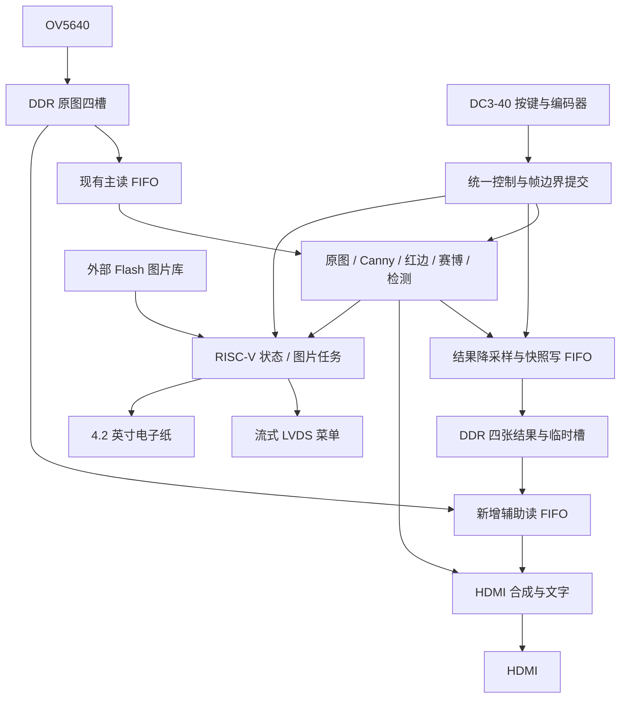

# Ti60 视觉交互项目总体规划：八模式、四帧对比与电子纸反馈

更新日期：2026-10-11。主工程为 `10_10_liu_ Ti60_Vision6_WaveFix`。本文依据当前源码、已有综合/布局报告和用户最新需求编制，是后续开发与验收依据；文中“建议、目标、预计”均不表示功能已经实现。

**推荐继续以当前主工程为基础，先释放片内 RAM，再完善阈值与 Canny，随后实现共享 DDR 的画中画/四帧对比，最后完善人数提示和手势—Flash—电子纸联动。** 人脸首版优先重新开放主工程已有分支，而非追加另一套检测链。

本次只生成规划文件，未修改三个工程的源码、约束、固件或 IP，未重新编译、下载或写 Flash。DC3-40 外接按钮已经由用户接好并测试通过，按既有接线使用；不重新安排物理引脚。

## 1. 本轮确定的范围与工程分工

### 1.1 已确定的条件

- 使用微雪 4.2 英寸、400×300 黑白电子纸；用户已完成点亮和图片显示。
- 常用按钮直接接 DC3-40 普通 IO，接线与按钮硬件测试已经完成。这里只定义软件事件和操作。
- 四帧对比保存采样时的**处理后结果**，允许四格使用不同算法、不同阈值；参数随图片保存。取消录像与回放。
- 电子纸图片库放外接板卡 Flash，固件不内置完整图片数组，也不在片内 RAM 保留整张图片。
- HDMI 显示视觉结果，LVDS 显示模式、阈值、采样状态、人数提示和电子纸状态。
- 当前 OV5640、DDR、HDMI、LVDS 底座继续沿用。换摄像头列为后续独立评估，不阻塞本轮集成。

### 1.2 工程用途

| 代号 | 工程/资料 | 使用方式 |
|---|---|---|
| A | [当前主工程](<D:/yilingsi_fpga/Efinity_Project/2026.10.11/10_10_liu_ Ti60_Vision6_WaveFix>) | 唯一集成基础，保留相机、DDR、HDMI、LVDS、RISC-V、手势与已点亮的电子纸 |
| T | [阈值参考工程](<D:/yilingsi_fpga/Efinity_Project/2026.10.11/10.11 guo Canny_threshold_full_project>) | 提取阈值控制、帧边界提交、数值面板与相关测试；不整体覆盖 A 顶层 |
| F | [人脸参考工程](D:/yilingsi_fpga/Efinity_Project/2026.10.11/Ti60F225_OV5640_Face_Reproduction) | 提取连通域、框过滤与脸颈分离思路；按需替换 A 中对应模块 |
| P | [此前总体规划](D:/Github_Project/Efinity-Project/项目总体规划.md) | 继承帧边界提交、事件去重、异步外设等原则；旧目录、六模式、回放、旧电子纸状态由本文更新 |
| D | [DDR/PiP 参考工程](D:/yilingsi_fpga/Efinity_Project/2026.10.10/Ti60_OV5640_DDR3_6s_PiP) | 只借鉴槽保护、读写响应确认和突发边界处理；不迁入 192 帧回放结构 |

正式实施时，从 A 建立一个独立集成副本，各阶段保存报告和可回退版本。原 A、T、F 保留，不在多个工程内同时修改同一功能。本次未创建集成副本。

## 2. 当前资源与可行性结论

### 2.1 当前基线

以下数据来自 A 的 2026-10-10 23:08 布局报告及 [build_verified.json](<D:/yilingsi_fpga/Efinity_Project/2026.10.11/10_10_liu_ Ti60_Vision6_WaveFix/reports/build_verified.json>)，是已有构建结果，不是本次重编译。

| 资源 | 已用/总量 | 使用率 | 对规划的意义 |
|---|---:|---:|---|
| XLR | 35,076 / 60,800 | 57.69% | 还有逻辑空间，但大规模流式连通域可能增加逻辑与布线压力 |
| Memory Blocks（下文简称 RAM 块） | 244 / 256 | 95.31% | **只剩 12 块，首要瓶颈** |
| DSP | 37 / 160 | 23.12% | 不必为了省 RAM 无条件牺牲乘法性能 |
| GBUF | 14 / 32 | 43.75% | 新功能优先复用现有时钟域 |
| 最差 setup / hold 裕量 | +0.302 / +0.017 ns | — | 当前报告通过；改 FIFO/仲裁/算法延迟后必须重新检查 |

对应 bit SHA256：`5af09cfd55abed8ee4f2bd0f480fe5d9e64663df576cac12d222f11113c1affc`。电子纸显示和 DC3-40 按钮的实物状态采用用户确认；新增八模式功能尚未实物验收。

### 2.2 RAM 主要花在哪里

依据 A 的 [map 报告](<D:/yilingsi_fpga/Efinity_Project/2026.10.11/10_10_liu_ Ti60_Vision6_WaveFix/outflow/Ti60_Demo.map.rpt:5288>)，以下是不重复计数的当前构成：

| 分组 | RAM 块 | 说明 |
|---|---:|---|
| RISC-V SoC | 51 | 固定 32KiB 程序 RAM 占 32 块；CPU/cache 等 16 块；UART/SPI FIFO 等 3 块 |
| DDR 控制器与现有视频 FIFO | 46 | DDR 控制器 30 块，现有读写 FIFO 共 16 块 |
| 视频对齐延时 | 40 | RGB/同步 19、灰度 8、原始梯度 9、其他掩膜/边缘 4 |
| 已有肤色网格连通域 `face_grid_regions` | 34 | 已经综合进去，界面未设独立人脸模式不等于没有该模块 |
| 手势分支 | 33 | 包含连通域、行缓存与对齐 |
| Canny 路径 | 20 | 灰度窗口、高斯/中值梯度、NMS、局部迟滞 |
| HDMI 与 LVDS 两套字模 | 16 | 各 8 块，可研究紧凑字模 |
| 肤色形态学 | 4 | 流式行缓存 |
| **合计** | **244** | 与布局报告一致 |

电子纸 SPI/APB 控制模块本身在当前报告中为 0 RAM、0 DSP；约 15KB 图片通过固件占据已经固定分配的程序 RAM。把图片移出固件与真正缩小程序 RAM 是两个步骤。

此前释放并行 RGB LCD/触摸接口，纯接口释放 28 个物理管脚；电子纸使用其中 6 个后，净释放 22 个。它没有释放 Canny/DDR 的 RAM、DSP 或 PLL，内部视频时序仍为 HDMI/DDR 所需。不能把空闲管脚当成片内存储余量。

### 2.3 八项功能的判断

| 功能 | 判断 | 主要前提 |
|---|---|---|
| 动态 Canny 改善 | 可行，先调参再改有限迟滞传播 | 正确诊断断边原因；同步处理视频延迟；不承诺运动时绝不破碎 |
| 右上角原图 PiP | 可行 | 增加共享 DDR 读客户端与窄 FIFO，绑定同一原图帧 |
| 四帧处理结果对比 | 可行，DDR 容量需求小 | 必须同时支持四格显示和取帧期间的实时算法输入，不能只有四张地址表 |
| 编码器调阈值 | 可行，增量较小 | 统一参数控制，LOW/HIGH/LINK 与帧边界提交 |
| 人脸候选与人数提示 | 首版可先恢复已有模块，预计小幅增量 | 检测质量另行验收；不能直接追加 F 全链路 |
| RAM 与 LVDS UI 优化 | 应优先做 | 缩小实际生成的存储结构，继续流式菜单 |
| 手势录入与识别 | 可沿用 H5 个人模板基础 | 分离 K3 录入；按新源帧确认，不靠重复显示帧重复计数 |
| 手势驱动 Flash 图片/电子纸 | 可行 | 可读 Flash SPI、图片索引、CRC、异步刷新与事件去重 |

## 3. 最终八个模式与显示规则

用户看到的模式编号统一为 1～8。内部旧模式编号可暂时映射，但应由一个集中映射表管理，不能把新“模式 6”直接当成旧手势模式。

| 模式 | 名称 | HDMI 主画面 | PiP/其他操作 |
|---|---|---|---|
| 1 | 原图彩色 | RGB565 原图转换后的彩色画面 | 不启用 PiP |
| 2 | Canny | 黑底白色二值边缘 | K1 长按开/关右上角彩色原图 PiP |
| 3 | Sobel 红色彩色边缘 | 原图上叠加红色 Sobel 边缘 | 同模式 2 |
| 4 | Sobel 赛博 | 保留现有赛博着色效果 | 同模式 2 |
| 5 | 四帧对比 | 左上、右上、左下、右下四张处理结果；空格显示占位提示 | K4 选下次算法，K2 采样，K2 长按清空；不启用 PiP |
| 6 | 阈值调节 | 当前阈值下的实时 Canny，配少量数值提示 | 编码器调 LOW/HIGH/LINK；K4 切步长 |
| 7 | 人脸轮廓/人数提示 | 原图加肤色人脸候选框 | 显示检测数与有效状态，LVDS 显示人数估计 |
| 8 | 手势识别 | 原图、手框、轮廓预览、录入/识别提示 | K3 录入；确认事件映射外部 Flash 图片并驱动电子纸 |

模式 2、3、4 共用一个 PiP 开关；离开后保留设置，重新进入这些模式继续使用。其余模式屏蔽 PiP。模式 6 调好的 Canny 阈值继续用于模式 2 和模式 5 的 Canny 采样。

模式 1～4、6～8 的 K2 冻结含义是“锁定原图来源，允许观察该帧处理效果”；相机仍可以继续写其他 DDR 原图槽。模式 5 的 K2 是“保存一次处理结果”，不是切换冻结。进入模式 5 恢复实时采样源，离开时也从实时状态开始；已经保存的四格仍保留。

## 4. 已接好的按钮：只规定软件功能

**推荐使用已有接线中的四个逻辑功能键 K1～K4，加编码器旋转与按压。** 共 4 个独立按钮、1 个编码器按压；如果已经接了更多按钮，剩余按键暂留扩展，不必为了八个模式再增加按钮。这里的 K1～K4 是软件角色，以已测试的 DC3-40 实际信号对应，不更改约束与接线。

### 4.1 操作表

| 操作 | 普通视觉模式 | 模式 5：四帧 | 模式 6：阈值 | 模式 8：手势 |
|---|---|---|---|---|
| K1 短按 | 下一全局模式 | 直接进入模式 6 | 直接进入模式 7 | 回到模式 1 |
| K1 长按 | 仅模式 2/3/4：PiP 开/关 | 暂不分配 | 暂不分配 | 暂不分配 |
| K2 短按 | 冻结/恢复 | 采一张完整处理结果 | 冻结/恢复，用于观察参数效果 | 非录入期间冻结/恢复，冻结停止新识别事件 |
| K2 长按 | 暂不分配 | 清空四张结果 | 暂不分配 | 暂不分配 |
| K3 短按 | 暂不分配 | 暂不分配 | 暂不分配 | 录入过程中确认当前步骤 |
| K3 长按 | 暂不分配 | 暂不分配 | 暂不分配 | 进入/重新录入三类个人模板 |
| K4 短按 | 暂不分配 | 原图→Canny→红边→赛博，选择下一张结果的算法 | 步长 1→4→8 循环 | 手动重显当前图片，仍受屏幕忙/刷新间隔限制 |
| 编码器旋转 | 暂不分配 | 暂不分配 | 增/减选中阈值 | 暂不分配 |
| 编码器按压 | 暂不分配 | 暂不分配 | LOW→HIGH→LINK 循环 | 暂不分配 |

**不采用“模式 5 中 K1 只能循环算法，清空以后才能退出”的方案。** K1 始终是全局模式键；K4 专门选四帧采样算法，操作更容易记，也不会困在四帧模式。

### 4.2 事件与状态规则

1. 沿用既有短按释放触发、长短互斥语义。长按松手后不再触发短按，防止 PiP 切换同时切模式、清空同时再采一张。
2. 四帧采集中再次短按 K2 只提示“采样中”，首版不排队；长按清空则取消待提交结果，已发出的 DDR 事务正常收尾后回收。
3. K3 录入前若被冻结，先恢复实时并等待新有效源帧；不能用冻结画面录入。录入期间 K2 不执行冻结，LVDS 提示“录入中”；K1 仍可退出。普通模式切换保留已经完成的模板，退出当前未完成录入。
4. 三类模板仍采用现有手掌/点赞/单手小爱心录入流程；招手依赖张掌与摆动时序。复位、重新下载、重新上电后仍需重录；模板持久化不列入首版。
5. 编码器 A/B 解码沿用已验证硬件输入，软件不能直接把整套按钮消抖延时套在每个编码器相位上。高速旋转事件先累加，再按整帧提交参数。
6. 模式切换涉及读路径时先停止新事务、排空在途返回，再切 FIFO/目录；UI 可短暂显示“准备中”，不展示半帧。

## 5. 总体结构：一套底座、两条显示读路径

- **主读路径**保留现有原图→算法流。模式 5 平时可暂停它；取帧时恢复并预热，处理源帧产生待保存结果。
- **辅助读路径**在两种用途间复用：模式 2/3/4 读取原图 PiP，模式 5 读取四格结果；两者不同时开启。
- **快照写路径**保存处理后的降采样 RGB565。CPU 只管理元数据，不搬运视频帧。
- 保留唯一 DDR 控制器/PHY；增加客户端仲裁，不复制四套完整视频缓冲模块。
- RTL 负责高速视频、事件、帧边界控制；RISC-V 负责状态组织、Flash 小块读取和电子纸服务。当前 CPU 菜单写寄存器不能直接当成算法控制接口。

## 6. Canny：先找到断边原因，再以低 RAM 改善

### 6.1 已核实的问题

A 与 T 的 Canny、高斯、中值、NMS、双阈值和迟滞模块相同。T 增强的是调参与显示，并没有换成更完整的 Canny。

A 的 [hysteresis_local.v](<D:/yilingsi_fpga/Efinity_Project/2026.10.11/10_10_liu_ Ti60_Vision6_WaveFix/src/vision/hysteresis_local.v:68>) 只保留与强边直接相邻的弱边。因此“强—弱—弱—弱”中更远的弱边会消失，这是明确的近似限制。标准 Canny 的迟滞按弱边与确定边缘的连通关系保留边缘，不能把当前单级局部连接称为完整连通迟滞。[OpenCV 官方说明](https://docs.opencv.org/4.13.0/da/d22/tutorial_py_canny.html)

当前高低阈值都已接通。运动模糊、曝光/增益变化、低对比细线、NMS 方向量化也可能贡献断裂；不能只降低阈值就承诺动态画面完全不断边。

### 6.2 推荐实施顺序

1. 固定一组静止/运动场景，保存同源图像及参数。对照灰度、梯度、NMS、强/弱分类与最终结果，定位断裂出现的一级。
2. 接入编码器调参，先寻找低阈值与高阈值的有效组合，比较细线保留、断裂长度与噪点。高低阈值分别控制，避免一调全部同步乱跳。
3. 若局部迟滞确为主要瓶颈，新增 1～2 级有限传播：保留 2-bit 原分类，只把原本的弱候选在邻域确认后晋升，最后一级才输出二值边缘。
4. 每一级两行 1280×2bit，原始存储为 5,120bit；按现有双行数组结构预计约增加 2 个 RAM 块/级，实际看综合。RGB/灰度/同步对齐可能额外增加存储，不能只预算传播行缓存。
5. 同步重算所有输出延迟与 x/y 对齐，尤其是红边、赛博、PiP 边框、截图取样位置；不能只改算法文件。
6. NMS 当前一边严格大于、一边大于等于，用于处理梯度平台。先用斜线、转角、平台测试，不直接改成两边均大于等于。

暂不采用无条件膨胀或前帧边缘直接 OR：前者容易把噪点连起来，后者在运动时容易拖影。有限传播能改善一定长度的弱链，但仍不是任意距离的递归连通。

720p 一张 1-bit 图为 115,200B，按容量理想下限约 90 个 10kbit RAM 块；2-bit 类别图约 180 块，实际打包还可能更多。因此首版不为完整 Canny 新增片内整帧缓存。以后若做 DDR 上的完整连通迟滞，另评估帧延迟和带宽。

### 6.3 阈值控制

建议保留 12-bit 参数接口，但当前 8-bit Sobel L1 梯度的保守上界为 2040，首版采用 `1 ≤ LOW < HIGH ≤ 2040`；若梯度定义变化，重新推导并更新范围。

- LOW：仅修改低阈值，上限为 HIGH−1。
- HIGH：仅修改高阈值，下限为 LOW+1。
- LINK：两值等量移动，保留间距；任一触及边界，两值一起停止。
- 步长初值 1，K4 可切 4/8。LINK 不能沿用旧代码“低阈值 +8、高阈值 +16”的不等量操作。
- 编码器/维护 UART/CPU 共用一个控制入口，维护 shadow；在**算法输入完整帧边界**提交 active，并生成配置版本。UI 显示已生效值，待提交时显示“应用中”。
- Canny 的 LOW/HIGH 与 Sobel 的 `SOBEL_T` 分开。首版 Sobel 阈值保留固定/维护参数，不因调 Canny LOW 而悄悄改变模式 3、4。
- 模式 5 的算法与配置在一次取帧事务开始时绑定；中途改 K4 或其他参数只影响下一次。

## 7. 画中画：同一帧原图的全视野缩略图

建议 PiP 为 **320×180**，HDMI 1280×720 右上角预留 16 像素边距，左上坐标 `(944,16)`，内图右下为 `(1263,195)`，外加细边框与“原图”标签。

PiP 是完整 1280×720 原图按 4 倍取样后的缩略图，不是只截右上角原图区域。首版使用隔行/隔列取样；若细节混叠明显，再评估小范围平均，不先引入大缩放器。

处理主图与 PiP 必须绑定同一个已提交的 `raw_slot/frame_id`。冻结时二者同时保持该来源；不能主图一帧、PiP 下一帧。原图槽至少保护到两个客户端的最后在途读结束。

当前只有一路顺序 DDR 读指针和 RFIFO，不能靠改输出坐标就获得完整原图 PiP。需要辅助读描述符、返回数据归属、取样与 FIFO；PiP 欠流时标记该帧无效并显示明确占位，不能用错误数据覆盖主画面。首版没有上一张 PiP 像素缓存，不承诺欠流时保留上一完整图像。

## 8. 四帧对比：保存当时结果，操作始终能退出

### 8.1 用户操作

1. 进入模式 5，显示四个占位格；已有图片保留。LVDS 提示下次采样算法和当前阈值。
2. K4 选择原图/Canny/红边/赛博。K2 请求取一张，完成后按**左上→右上→左下→右下**顺序放置。
3. 四格满后，后续 K2 循环替换下一个位置；UI 显示“下一张替换左上”等提示，保留各格采样序号，避免误以为四格总按时间升序排列。
4. K2 长按清空全部，保留当前算法和阈值。清空仅失效目录，无需把 DDR 整块写零。
5. K1 随时进入模式 6 调阈值；调好后可继续切回模式 5 采新结果。已有结果不随新参数变化。

四格本质是四次抓拍，不是“四个连续视频帧”或录像。每格 640×360，占据 HDMI 对应四分之一；标签在显示时叠加，保存的像素不含 HUD、PiP 或菜单。可标注算法、LOW/HIGH 或 SOBEL_T、源帧号、采样序号及配置版本。

已存的是处理后像素，不能重新调参数后重算旧图，也不能只靠元数据恢复其原图；需要该能力时必须额外保存原图，本轮不做。

### 8.2 原子取帧流程

`K2请求 → 绑定算法/配置/已提交原图槽 → 恢复主读并预填 → 完整预热帧 → 下一完整处理帧隔2行/列采样 → DDR写完成确认 → HDMI帧边界更新四格目录`

- 模式 5 空闲时辅助 FIFO 持续供四格显示，主算法读可以暂停。采样时，主读负责隐藏的实时算法输入，辅助读继续四格显示。
- 同一受保护原图源用于预热与采样，不使用半写入的相机帧。预热后必须确认算法、延迟与源帧标记有效。
- 从算法着色完成、HUD/PiP 合成之前抽取 640×360 RGB565，共 230,400 像素、460,800B。
- 四个可见逻辑槽之外保留第五个临时物理槽。先写临时槽，检查像素数、FIFO 状态及全部真实 DDR 写响应，成功后才换入可见目录。
- 目录在 HDMI 帧边界更新；旧图等待旧读事务全部返回后才回收成新的临时槽。
- 如果 FIFO 溢出、读欠流、长度不符、DDR 返回错误或超时，丢弃新结果，原来的四格保持完整。
- 清空/切模式发生在采集中时，取消未完成提交并收尾在途事务，不能复位正在返回的 FIFO 后把旧数据送进新画面。

### 8.3 DDR 地址和容量草案

以下按字节地址规划，实施前核对当前 DDR IP 的可寻址范围和实际器件；这里不自动修改 IP 配置。

| 区域 | 地址/跨度 | 用途 |
|---|---|---|
| 原图四槽 | `0x00000000～0x00FFFFFF` | 沿用 4MiB 槽距，预留 16MiB |
| 快照物理槽 0 | `0x01000000`，跨度 `0x80000` | 图像有效长度 `0x70800` |
| 快照物理槽 1 | `0x01080000`，跨度 `0x80000` | 同上 |
| 快照物理槽 2 | `0x01100000`，跨度 `0x80000` | 同上 |
| 快照物理槽 3 | `0x01180000`，跨度 `0x80000` | 同上 |
| 快照物理槽 4 | `0x01200000`，跨度 `0x80000` | 临时槽，提交后与旧槽交换身份 |
| 下一空闲边界 | `0x01280000` | 总预留 18.5MiB |

四张可见图有效数据合计 1,843,200B；包括第五槽为 2,304,000B，按槽距预留 2.5MiB。大图放 DDR，片内只放必要 FIFO/行缓存，不能在 FPGA RAM 新建四张图片缓存。

## 9. DDR 读写与带宽：必须先解决的集成点

### 9.1 调度改造

A 的 `AXI4_AWARMux.v` 仅合并一个写口与一个读口，不是现成的多客户端交换器。保留它时应在其前面增加客户端仲裁。

- 读客户端：主算法原图、辅助 PiP/四格。写客户端：相机原图、快照。
- 每个读任务保存 base、行跨度、行内位置、剩余长度与目标 FIFO；返回 owner 保持到真实 RLAST。写 owner 保持到 WLAST 及对应 B 响应完成。
- 四格一行先读左图 640 像素、再读右图 640 像素；上下两组按行切换。每段 1280B，不需要四个独立 RFIFO。
- 突发长度同时受行剩余长度、控制器最大 burst 与 AXI 4KiB 边界限制，不能跨边界。
- 原图槽保护从“一个 read_slot”改为保护集合/引用计数，覆盖主读、PiP、抓拍来源和在途事务；相机不得覆盖这些槽。
- 目前顶层部分 BVALID/BRESP/RRESP 被接成常量，严格的快照提交必须接真实响应并检查错误；不能只看到地址/像素计数到尾就说 DDR 写完。
- 以显示低水位、相机高水位及等待时间调度；视频期限优先，同时保证相机和快照不长期饿死。采样源一旦启动不能丢像素，必须先预留带宽与缓冲。

### 9.2 数据量预算

以下使用 RGB565、1280×720、**相机 30fps、HDMI 60Hz 的规划假设**，相机实际帧率尚需测量。单位为十进制 MB/s；这是活动帧期间的数据量折算，不是 DDR 总线瞬时峰值，也不是实测可用带宽。

| 路径/场景 | 数据量 |
|---|---:|
| 相机原图写入 | 55.296 MB/s |
| 单路 720p 主算法读入 | 110.592 MB/s |
| 四格合计读入 | 110.592 MB/s |
| PiP 直接取原图行的 DDR 读取 | 27.648 MB/s |
| 640×360 快照在一个显示帧内写入 | 额外 27.648 MB/s |
| 普通模式，无 PiP | 165.888 MB/s |
| 模式 2/3/4，开启 PiP | 193.536 MB/s |
| 模式 5 空闲，主算法读暂停 | 165.888 MB/s |
| 模式 5 预热，主算法与四格同时读 | 276.480 MB/s |
| **模式 5 采样，四格显示＋主算法读＋快照写** | **304.128 MB/s** |

320×180 PiP 的输出量虽只有 6.912 MB/s，但直接取原图时，每四行读取一条完整的 1280 像素行再隔列抽样，实际 DDR 读为 27.648 MB/s。不能把输出像素量直接当成总线读取量。

如后续需要降 PiP 带宽，可在写侧额外生成连续存储的 320×180 原图缩略平面；它还需要写入、双缓冲与帧绑定，不列入首版必做。

新增主/辅助欠流、相机/快照溢出、DDR 响应错误、未完成快照与槽冲突计数。在最重采样场景下测实际吞吐、最大服务间隔和 FIFO 水位；若达不到要求，先调整仲裁、突发和缓冲，不能仅凭 DDR 标称频率宣称通过。

参考 D 的槽保护和响应确认思想可复用，但其 `camera_packets` FIFO 在已有报告中映射为大量 FF/LUT、0 RAM；另一路 PiP FIFO 占 8 RAM 块。新工程采用可确认推断片内 RAM 的窄异步 FIFO，不整套复制参考。

## 10. 人脸/人数：先恢复，再优化或替换

### 10.1 首版优先恢复 A 的已有分支

A 已有 YCbCr 肤色判别、形态学、网格连通域、最多 8 个框和候选数量；`face_grid_regions` 的 34 RAM 已在 244 块中。旧六模式没有独立人脸入口，但检测开关和 HDMI 框选路径存在。

因此模式 7 首版可启用这条路径，把 `count/boxes/valid/overflow/source_frame_id` 发布给 HDMI 与 LVDS，预计主要增加少量控制、状态跨时钟与显示资源；精确增量以后续综合确认。**重新开放它，和追加 F 全链路，是两种完全不同的资源成本。**

F 是肤色连通区域检测，并非神经网络/身份识别。其肤色源码实际是饱和 `R-G` 的单条件范围判别，不是注释所说的完整 YUV；不要直接换掉 A 的多条件 YCbCr 前端。

### 10.2 为什么不能简单叠加 F

| 已有报告中的模块 | RAM 块 | FF / LUT | DSP |
|---|---:|---:|---:|
| A 网格连通域 | 34 | 2,158 / 1,490 | 4 |
| F 7×7 圆盘滤波 | 6 | 54 / 54 | 0 |
| F 垂直开运算 | 16 | 44 / 70 | 0 |
| F 流式 CCL | 13 | 8,311 / 7,042 | 1 |
| F 框过滤 | 0 | 1,108 / 2,184 | 12 |
| F 框显示 | 0 | 732 / 611 | 0 |

F 前端相关存储合计 35 块，超出 A 当前 12 块余量；FF/LUT 也明显增加。F 整机资源低不代表把它追加进 A 的增量低。

### 10.3 优化路线

**路线 A，优先试验：** 将网格从 8×8 改为 16×16。网格从 160×90 降为 80×45，队列从 14,400×15bit 降为 3,600×13bit；队列及网格双 bank 的原始存储估算从 244,800bit 降至 54,000bit。实际 RAM 节省需综合，不能直接用原始 bit 数当作最终块数。

只改变网格粒度，输入仍为 1280×720 原坐标：每 cell 肤色占用门限可由 `24/64` 改为 `96/256` 作为起点；已经换算到像素单位的框宽高/面积门限不机械乘 2/4。粒度取整会变化，面积代理也不是逐像素肤色面积。要比较小脸漏检、相邻脸合并和框偏差，再决定是否采用。

**路线 B，必要时替换：** 保留 A 肤色和已有形态学，以 F 的流式 CCL 替换 34 块网格模块，CCL 本身为 13 块，存在约 21 块的 RAM 节省候选；但会多约 6 千 FF、5 千 LUT，框过滤还需资源。不要同时追加 F 的 6＋16 块滤波。框几何过滤可在空闲时串行计算，共用乘法器。

先比较“原网格、粗网格、替换 CCL”三版的检测质量与资源，再选最终方案；不为追求块数单独接受明显更差的人数效果。

### 10.4 人数显示含义

- 对外建议写“景区人数：X（当前画面估计）”，详细状态标“可见人脸候选/有效性”。它不是整个景区总人数，也不是跨时段去重访客数。
- 首版显示候选数；再加最多 8 个轻量轨迹，以位置/重叠匹配、连续新源帧确认、短时丢失保持和超时删除，减少跳数。
- A 的 `bbox_tracker.v` 只挑最大候选，不能直接当多人跟踪器。确认计数使用新的相机源帧号，不能把 60Hz 重复显示同一帧当成多次观察。
- 冻结显示“冻结快照”；检测未准备好、溢出或图像失效显示“未知/暂不可用”，不能当成 0 人。
- 手、手臂、肤色背景会误检，侧脸、遮挡、脸颈连通会漏检或合并。先限定光照、距离、姿态与背景，再以标注样本定义准确率和人数误差。

## 11. RAM 优化顺序与资源门槛

| 优化项 | 候选收益 | 条件与取舍 |
|---|---|---|
| 图片移外 Flash，程序 RAM 32→16KiB | 约 16 块 | 必须同时缩小生成的 SoC RAM、链接空间和初始化文件；检查驱动、缓冲与栈 |
| 程序 RAM 进一步到 8KiB | 相比当前约 24 块 | 仅在实际固件/缓冲/栈确实装得下时使用，不预先承诺 |
| 缩减 I/D cache | 最多约 12 块候选 | 需重新生成配置，并测 CPU 菜单/Flash/电子纸服务性能；不是直接删数组 |
| 两套字模按实际字符紧凑存储 | 初估约 3 块 | 统一字索引、位图和生成脚本；新 UI 增字可能抵消收益 |
| 网格存储缩小或以 CCL 替换 | 可能有较大收益 | 与识别精度、FF/LUT、时序同时比较，不能重复计算两条路线的收益 |
| 对齐延迟与重复算法整理 | 待综合 | 当前 40 块对齐存储不能随意删除；保留红边/赛博真正需要的原始梯度 |

程序 RAM 的直接依据：A `firmware/linker.ld` 固定 32KiB，`vendor/EfxSapphireSoc.v` 有四个 8192×8 数组。当前固件二进制约 15,864B，其中图片 15,000B。图片外移后代码会新增 Flash/CRC/索引/状态机，因此不能用当前约 736B 的 `.text` 推断最终能缩到极小 RAM。

只关闭运行模式或将 enable 拉低不会自动回收这些静态存储。优先移除最终八模式不再需要的调试分支，或用参数在生成阶段裁剪；不能删掉仍被赛博、手势、同步对齐使用的模块。

**建议门槛：** 首轮优化争取降到 ≤220/256，但它只是里程碑，不是完整集成的充分条件。每阶段合入前按“当前实际 RAM＋尚未实现的全部增量预算 ≤225/256”重新准入；超过 230 块应重新评审。若还需 8 块 FIFO 和 4 块 Canny，扩展前基线必须 ≤213，UI/新增对齐还要继续扣除；例如它们再需 3 块，基线应 ≤210。资源不闭合时，提前做 cache、网格或冗余路径优化，再增加功能。XLR 暂以 ≤40,000 为预算目标；若采用大 CCL 替换则重新评估。最终目标是正时序、无欠流与可维护余量，不能只看总块数。

新增辅助读 FIFO 与快照写 FIFO 采用 16bit 窄结构，DDR 端抽样/打包为 128bit。两者合计初估 4～8 RAM 块；Canny 额外传播初估 2～4 块，新增对齐和 UI 另计。所有数字为候选预算，禁止把各项估算相加后当作已达到的最终资源。

## 12. LVDS UI：保留流式渲染，显示当前上下文

当前 LVDS 为 1024×600 流式菜单，没有整帧缓存；现有菜单只有六项。建议改为 **2 行×4 列模式卡片**，顶部显示项目名、当前模式、实时/冻结、视频有效状态，底部显示参数与当前按键用途。

| UI 区域 | 内容 |
|---|---|
| 八模式卡片 | 原图、Canny、红边、赛博、四帧、阈值、人脸、手势；当前项明显高亮 |
| 模式 5 状态区 | 已存 0/4～4/4、下次算法、下一替换位置、采样中/失败、各格源帧与参数 |
| 模式 6 状态区 | LOW、HIGH、LOW/HIGH/LINK 选中项、步长、已生效/应用中 |
| 模式 7 状态区 | 当前画面人数估计、检测有效性、实时/冻结、结果年龄 |
| 模式 8 状态区 | 三类录入完成情况、当前步骤、最近确认手势、目标图片、电子纸状态 |
| 底部操作提示 | 随模式显示 K1/K2/K3/K4/编码器的有效操作，不展示无效动作 |

电子纸状态使用“待显示、读取中、发送中、刷新中、完成、冷却、出错”等易懂文字；硬件计数器放维护页，不占普通演示界面。

继续使用字模 ROM、数字字符和简单矩形，不增加 1024×600×像素位宽的片内帧缓存。当前 APB 状态只有模式/冻结/health，需增加人数、阈值、手势、采样和图片任务状态；这些都是少量寄存器/元数据。

跨时钟采用稳定整组快照加请求/应答或异步 FIFO，不能逐位双触发同步一个多位数值。视频 active、源帧号、配置版本一起发布，LVDS 在自身帧边界采用一致状态。

## 13. 外部 Flash 图片库与电子纸任务

### 13.1 图片和存储格式

PC 预先生成 **400×300、1bpp、50B/行、15,000B/张** 的图片。首版不压缩，避免新增实时解码。固定左上起点、逐行扫描、字节高位优先与黑白极性，先用全白、全黑、四角标记和棋盘格校准；与当前驱动保持一致。

Flash 图片条目含 `image_id、格式版本、宽高、数据长度、数据偏移、CRC32`。手势事件按配置映射 image_id；比如招手→欢迎图、点赞→肯定图、比心→爱心图。图片文件和固件分开更新，Flash 分区与容量在实施时按实物型号确定。

固件只保留索引与 512B～1KiB 工作缓冲。屏幕当前需写两块 RAM 时，从 Flash 重读同一张图两遍，不建立 15KB 全图缓存。先分块完整校验 CRC，再读取并发送；两次发送分别对实际读出数据重新累计 CRC，长度与 CRC 均匹配后才发刷新命令，避免预校验后重读出错。失败不刷新，下一任务完整重写两块屏幕 RAM。显示任务期间禁止改写该图片条目。

### 13.2 当前已有与待补齐部分

当前 A 的电子纸已经能显示内置静态图，固件写 `0x24/0x26` 后全刷并深睡。尚缺外 Flash 读取、图片索引、手势一次性事件与多次唤醒刷新管理。

SoC 已有 SPI 控制器，但当前其 SPI 外部输出没有用于图片 Flash。优先评估把该可读 SPI 接入已有板卡连接；电子纸现有逐字节写 SPI 不能直接当成 NOR Flash 读取口，后者需要命令/地址/连续 CS 与 MISO 接收。本轮不重新规划已验证按钮接线。

不要把外部图片 Flash 与 FPGA 配置 Flash 混用，除非实施时已明确分区和访问仲裁。首版图片库单独管理，图片更新过程不改写正在读的图。

### 13.3 联动状态机

`新手势确认 → gesture_event(seq/class/source_frame_id) → 更新最新目标图片 → 空闲时去重并启动 → 校验Flash图 → 唤醒/初始化屏幕 → 分块发送 → 发刷新 → 等BUSY完成 → 记录已显示键 → 休眠/冷却`

1. 保持同一姿态不逐帧刷新；稳定回到未知/离开后重新使能。招手按一次完整动作产生一次事件。
2. 去重键采用 `(image_id, CRC32/内容版本)`，同 ID 换图后仍需刷新。每个请求先更新最新目标，只有无活动任务、准备启动时才与“已显示”键比较。只有 BUSY 正常完成才提交“已显示”键；复位/重新配置后先设为未知。K4 手动重显显式强制请求，但仍检查忙状态与允许间隔。
3. 电子纸忙时只保留最新一个待显示键，不排长队，即使它等于旧的已显示键也不能提前丢弃。例如原来显示 A、正在刷新 B 时又请求 A，应在 B 完成后回到 A。当前任务绑定固定图片与内容版本，不能发送半幅后换图。
4. 录入、冻结、退出手势模式时停止新自动事件；已开始的传输/刷新安全完成，未开始的自动待显示任务取消。
5. CRC、Flash 读取或格式失败不发刷新命令，保留已有画面并在 LVDS 报错。BUSY 超时停止任务，不阻塞视频与按键。
6. 深睡后下一次显示必须重新唤醒/初始化；不能直接把后续像素发给仍在休眠的控制器。
7. 刷新间隔与 BUSY 超时按当前 4.2 黑白 V2 驱动和实测设置，不套用旧 5.79 寸或三色 B 屏资料。先复用已验证全刷，再单独验证快速/局部刷新和残影维护策略。[微雪官方型号资料](https://www.waveshare.com/4.2inch-e-paper-module.htm)
8. HDMI 的手势确认与电子纸完成分别记录延迟；电子纸图片反馈不能按摄像头帧率更新，也不能把算法确认时间当成屏幕完成时间。

## 14. 开发阶段、通过条件和交付物

| 阶段 | 具体工作 | 进入下一阶段的条件 |
|---|---|---|
| 0：固化基线 | 建独立集成副本，保存源码/bit 哈希、资源/时序、现有视频与外设状态 | 原版本可回退；沿用已通过的 DC3-40 接线，建立软件事件对应表 |
| 1：释放 RAM | 外 Flash 单图读取→小块驱动→移除内置图→缩小实际程序 RAM；紧凑字模/cache 评估 | 图片仍可显示、CRC/错误处理通过、RAM 真实减少；≤220仅首轮里程碑，按全部后续增量继续释放 |
| 2：统一八模式与阈值 | 八模式映射、K1～K4/编码器、LOW/HIGH/LINK、HDMI/LVDS 已生效值 | 长短互斥、饱和、冻结、跨模式保留参数、整帧提交通过 |
| 3：Canny 改善 | 诊断对照、阈值标定、必要的有限传播、全链路延迟修正 | 同源运动序列改善，噪点/拖影无明显恶化，边界与对齐通过 |
| 4：共享 DDR 与 PiP | 真实响应、客户端 owner、槽保护、辅助读、右上原图 PiP | 同源帧、冻结、切模式、长运行无错帧/欠流/覆盖冲突 |
| 5：四帧采样 | 临时槽、处理结果取样、元数据、四格辅助读、循环替换/清空 | 最重约304MB/s假设场景下主/辅助读均无欠流且无溢出；失败不损坏旧图；目录原子提交 |
| 6：人数提示 | 开放既有分支、LVDS 数量/有效性；按质量决定粗网格或 CCL 替换 | 空/单/多人标注测试，误检/漏检/数量误差可接受，资源及时序通过 |
| 7：手势联动 | K3 录入、新源帧确认、事件去重、图片映射与异步电子纸队列 | 三类动作、未知/冻结/退出/忙/读错/超时均符合规则 |
| 8：整机收尾 | UI 统一、裁剪调试分支、资源/时序复查、组合场景长运行 | 八模式逐项实拍通过，报告、固件、bit 和源码版本一致 |

阶段 2 可先做控制仿真，阶段 6 的“开放已有分支”也可较早验证；若网格优化是资源预算闭合所必需，应提前完成其质量与资源比较。完整 DDR/PiP/快照扩展仍应在 RAM 释放后集成，各阶段同时执行第 11 节的增量预算准入。每阶段只合入一个主要变化，保留通过版本，不一次把所有参考工程拼在一起。

### 14.1 必做的针对性验证

- Canny：强边、1/2/8 像素弱链、八方向、孤立弱边、梯度平台、转角、行帧边界与固定运动序列；软件参考先使用相同有限传播规则，再单独比较完整 Canny。
- 控制：一按一事件、长按不追加短按、编码器上下限/LINK、帧中输入下一帧生效、采样配置锁定。
- DDR：随机背压、4KiB 边界、真实 B/R 错误、模式切换 drain、源槽保护、第五槽交换、采样失败、清空中途取消、最重组合水位。
- 四格：四种算法及不同阈值混存，换阈值后旧图不变，完整帧无撕裂，四格满后提示正确替换位置。
- 人脸：空画面、单/双/多人、贴边、小脸、肤色背景/手臂、脸颈连通、遮挡/离场、候选超限；新源帧与重复显示帧分别验证。
- 手势/电子纸：重录与切模式保留已完成模板，同姿态只触发一次，忙时合并最新图，CRC 错误不刷新，深睡再唤醒，视频不中断。

每阶段交付：修改说明、资源/时序报告、必要仿真结果、当前 bit/固件哈希、实物观察记录及待确认项。仿真、综合通过和实物效果分别记录，不能互相替代。

## 15. 移植入口与后续决策

| 工作 | 主要文件/模块 |
|---|---|
| 参数与统一事件 | A/T `src/parallel/uart_params.v`、`rtl/gesture_key.v`；新增集中模式/编码器控制层 |
| Canny 与延迟 | A `src/parallel/canny_stream.v`、`src/vision/hysteresis_local.v`、`src/vision/nms3x3.v`、`src/parallel/parallel_video.v` |
| 阈值 UI | T `rtl/canny_threshold_panel.v`、`canny_ui_glyph_rom.v`、`tools/generate_canny_ui.py` |
| 阈值验证参考 | T 现存 `tools/test_threshold.ps1` 与 `reports/tb_threshold_*.log`；脚本引用的三个 `sim/tb_threshold_*.sv` 缺失，实施前补齐或重新建立测试平台 |
| DDR/帧目录 | A `src/axi/axi4_ctrl.v`、`frame_buffer_select.v`、`AXI4_AWARMux.v`、`example_top.v` |
| 人脸 | A `src/parallel/face_grid_regions.v`；F `streaming_connected_components`、`bbox_filter_720p` 及相关前端 |
| 手势 | A `rtl/gesture_branch.v`、`gesture_wizard`、`gesture_templates`、`gesture_stabilizer`、`gesture_wave` |
| LVDS/CPU 状态 | A `rtl/menu_renderer.v`、`menu_lcd_apb.v`、`menu_status_cdc.v`、`riscv_menu_top.v` |
| 图片与程序 RAM | A `firmware/epaper.c`、`firmware/linker.ld`、`vendor/EfxSapphireSoc.v`，以及 SoC 生成配置 |

T 顶层和 `riscv_menu_top.v` 不含 A 的电子纸接口，不能整体覆盖。D 的旧 DDR 几何配置也不能因文件可构建就照搬；实施前对照实物器件与当前 IP 可寻址范围核实。

摄像头后续评估以“相同分辨率/帧率/像素格式下的真实清晰度与总资源”比较。当前 RAM 主要在 CPU、缓存、算法和对齐，改 DVP/MIPI 接口不会自动释放这些存储。本轮先保留已工作的 OV5640 DVP，改善镜头对焦、曝光与算法；若后续换 MIPI，应单独计入接收/解包、时钟域与带宽，再决定是否值得迁移。

本规划的首版完成状态是：八模式能顺畅切换、Canny 动态断边得到可测量改善、PiP 同源、四格保存完整处理结果、阈值可控、人数提示有明确有效范围、手势事件可驱动外部 Flash 图片且电子纸任务不影响视频，同时保留 RAM 与时序余量。
